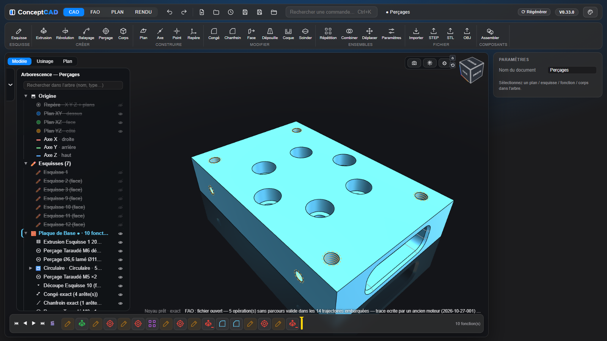
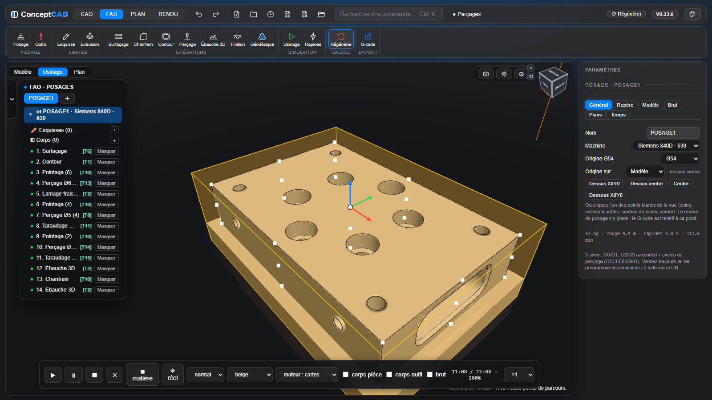
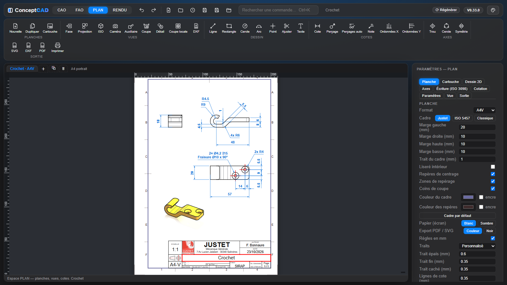
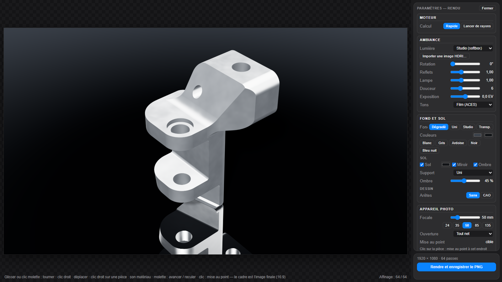

# ConceptCAD

**CAO paramétrique, assemblage, FAO, mise en plan et rendu, dans le navigateur.** Sur PC comme sur téléphone : rien à installer, pas de compte.

Ou installez-le depuis le site, dans Chrome ou Edge : icône d’installation de la barre du haut (ou de la barre d’adresse). Il a sa fenêtre et son icône, et il marche sans Internet ([Démarrage](docs/manuel/demarrage.md#installer-depuis-le-site)).

Version actuelle : **V0.94.7** · [Nouveautés](CHANGELOG.md) · [Manuel](docs/manuel/README.md) · [Exemples](Exemples)

## De l'idée à la pièce usinée

Un seul logiciel et un seul fichier `.conceptcad` pour dessiner la pièce, l'assembler, l'usiner, la mettre en plan et en faire une belle image. Une cote change : le solide, les parcours d'outil et les plans suivent.

### CAO

- Esquisses contraintes et cotées, splines, paramètres et formules.
- Solides à historique : extrusion, révolution, balayage, perçages taraudés, congés exacts, répétitions.
- Import STEP et STL, export STEP, STL, OBJ et FreeCAD.

Manuel : [Esquisse](docs/manuel/esquisse.md) · [Fonctions 3D](docs/manuel/fonctions-3d.md) · [Fichiers](docs/manuel/fichiers.md)

### Assemblage

- Tout est composant, comme dans Fusion 360 : pièces, sous-ensembles, fichiers liés.
- Visserie, goupilles, clavettes, rondelles et engrenages normalisés, posés d'un clic sur les trous.
- Liaisons animées, interférences, masse et centre de gravité.

Manuel : [Assemblage](docs/manuel/assemblage.md)

### FAO

- Posages, opérations 2,5D et 3D, perçage reconnu sur le modèle, usinage 3+2.
- Simulation de la matière enlevée, avec l'outil réel et le vrai brut.
- G-code Siemens 840D et Fagor 8065.

Manuel : [FAO](docs/manuel/fao.md)

### PLAN

- Planches A4 à A0, cartouche, nomenclature.
- Vues, coupes et détails aux arêtes exactes ; cotes qui suivent la pièce.
- Tolérances ISO, états de surface, sorties PDF, DXF et SVG.

Manuel : [PLAN](docs/manuel/plan.md)

### RENDU

- Images réalistes en 1920×1080 ou en 4K.
- Deux moteurs : rapide, ou lancer de rayons.
- Matériaux, patine, ambiances, 80 sols, appareil photo réglable.

Manuel : [RENDU](docs/manuel/rendu.md)

## Choisir sa version

C'est le même logiciel partout, et les fichiers passent d'une version à l'autre.

| Version | Pour qui | Lien |
|---|---|---|
| **En ligne** | Essayer tout de suite, sur PC ou téléphone | [Ouvrir ConceptCAD](https://bobfredgard.github.io/ConceptCAD/) |
| **Autonome** | PC sans Internet : un seul fichier, ouvert par double-clic | [Télécharger](https://www.dropbox.com/scl/fi/sne7f5a9y8dr659b2xrow/ConceptCAD-autonome.html?rlkey=fgd0w1r5816ake50vxtd4fnuj&dl=0) (≈ 23 Mo) |
| **Windows** | Vraies fenêtres Ouvrir et Enregistrer, double-clic sur un fichier | [Installateur](https://github.com/BobFredGard/ConceptCAD/releases/latest/download/ConceptCAD-Windows-setup.exe) (≈ 22 Mo) |
| **Mac** | macOS 12 ou plus récent | [DMG](https://github.com/BobFredGard/ConceptCAD/releases/latest/download/ConceptCAD-Mac.dmg) (≈ 45 Mo) |

Les applications Windows et Mac ne sont pas signées : le système peut afficher un avertissement au premier lancement. Détails et points pas encore vérifiés : [Démarrage](docs/manuel/demarrage.md).

## Premiers pas

1. Télécharger l'exemple [Perçages.conceptcad](https://github.com/BobFredGard/ConceptCAD/raw/main/Exemples/Per%C3%A7ages.conceptcad) : une plaque usinée complète, avec sa planche.
2. [Lancer ConceptCAD](https://bobfredgard.github.io/ConceptCAD/). Le premier lancement télécharge le noyau de calcul (≈ 43 Mo, de préférence en Wi-Fi).
3. Ouvrir le fichier (`Ctrl+O`).
4. Passer d'un espace à l'autre dans le bandeau du haut : **CAO**, **FAO**, **PLAN**, **RENDU**.
5. Modifier un paramètre (bouton **ƒx**) et regarder la pièce suivre.

D'autres projets à ouvrir sont dans le dossier [Exemples](Exemples) : Crochet, Support Pédale, Axe, Cavité Usinage, Malaxeur Retard, Engrenages.

## Le manuel

| Pour démarrer | Concevoir | Fabriquer et montrer | Aller plus loin |
|---|---|---|---|
| [Démarrage](docs/manuel/demarrage.md) | [Esquisse](docs/manuel/esquisse.md) | [FAO](docs/manuel/fao.md) | [Scripts et MCP](docs/manuel/scripts-mcp.md) |
| [Interface](docs/manuel/interface.md) | [Fonctions 3D](docs/manuel/fonctions-3d.md) | [PLAN](docs/manuel/plan.md) | [Développement](docs/manuel/developpement.md) |
| [Téléphone et tablette](docs/manuel/telephone.md) | [Assemblage](docs/manuel/assemblage.md) | [RENDU](docs/manuel/rendu.md) | [Journal des modifications](CHANGELOG.md) |
| [Souris, clavier et doigts](docs/manuel/raccourcis.md) | [Fichiers](docs/manuel/fichiers.md) | | |

## Sous le capot

- Noyau géométrique exact : **OpenCascade 8 compilé en WebAssembly** par nos soins, multicœur quand le navigateur et le PC le permettent.
- Affichage : three.js. Simulation et rendu sur la carte graphique (NVIDIA, AMD, Apple).
- Pour lancer depuis les sources, comprendre le dépôt ou livrer une version : [Développement](docs/manuel/developpement.md).

## Licences

- Code : **ISC** (voir `package.json`).
- `threejs/` : three.js 0.187 (empaqueté en script classique par `tools/three-entree.mjs`) et OrbitControls sous **MIT**, CSG.js.
- `threejs/rendu-rayons.js` : three.js (même version, copie isolée), three-mesh-bvh, three-gpu-pathtracer et fflate, sous **MIT**.
- `occt/` : OpenCascade Technology sous **LGPL**.

---

*Anciennement **MiniFusion** (renommé en V0.33.0).*
