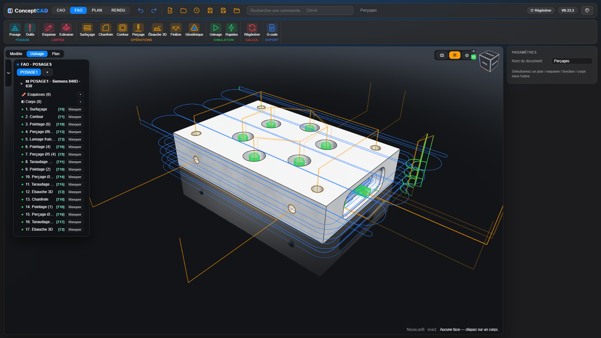
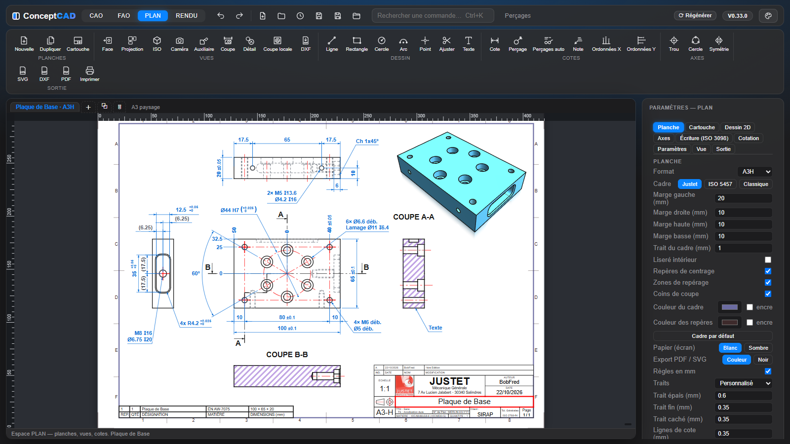
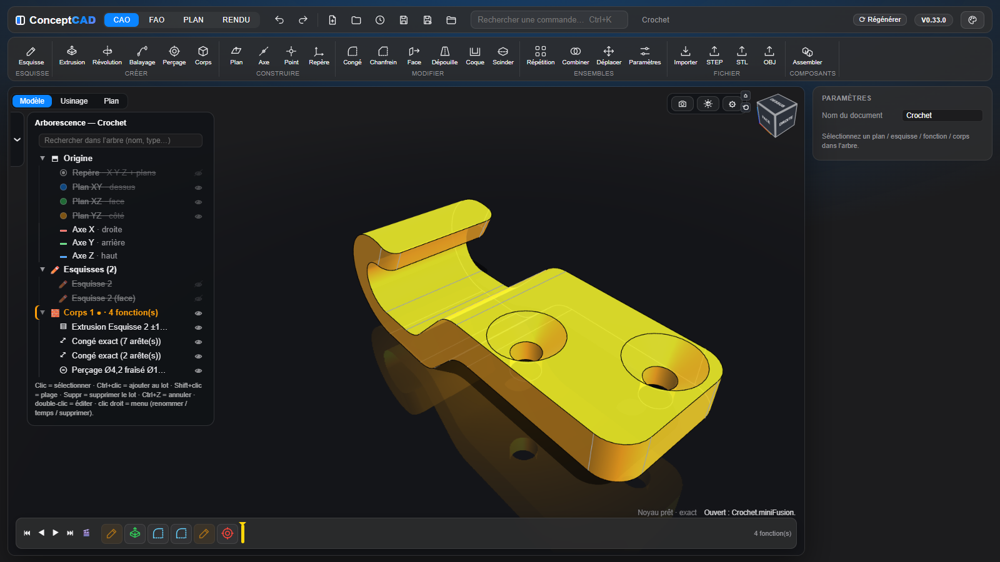

# ConceptCAD

*Anciennement **MiniFusion** (renommé en V0.33.0).*

**CAO paramétrique, assemblage, FAO, mise en plan et rendu, dans un seul fichier HTML.** On ouvre la page et on travaille, sur PC comme sur téléphone : ni installation, ni compte, ni connexion.

[](https://bobfredgard.github.io/ConceptCAD/)


Le noyau géométrique exact est **OpenCascade 8 compilé en WebAssembly** par nos soins (recette reproductible dans `occt-build/`). S'il n'est pas disponible, l'application bascule seule sur un moteur maillage (CSG). Version actuelle : **V0.63.8** (voir le [journal des modifications](CHANGELOG.md)).

**Sans Internet ni serveur** : `npm run autonome` fabrique `ConceptCAD-autonome.html`, un seul fichier d'environ 23 Mo (noyau OCCT 8 et Three.js à l'intérieur) qui s'ouvre par double-clic dans Chrome ou Edge.

| | |
|---|---|
|  |  |
| **CAO** : esquisses contraintes, splines, solides à historique, congés exacts, perçages taraudés | **FAO** : posages, 2,5D, 3D, 3+2, perçage, simulation, G-code Siemens et Fagor |
|  |  |
| **PLAN** : planches cotées ISO, coupes, cartouche, nomenclature | **RENDU** : images réalistes 1920×1080 ou 4K, moteur rapide ou lancer de rayons |

## Sommaire

- [Interface](#interface) : espaces, ruban, thèmes et icônes, vue 3D
- [Téléphone et tablette](#téléphone-et-tablette) : vue plein écran, panneau translucide, gestes
- [CAO](#cao) : esquisse, construction, fonctions 3D, corps et fichiers
- [Assemblage](#assemblage) : composants, normalisés, Dérivée, liaisons, références entre composants
- [FAO](#fao) : posage, opérations, perçage, simulation, 3+2, G-code
- [PLAN](#plan) : planches, vues, coupes, cotation, sorties
- [RENDU](#rendu) : deux moteurs, matériaux et patine, HDRI, finition, calques
- [Souris, clavier et doigts](#souris-clavier-et-doigts)
- [Démarrage](#démarrage) · [Scripts et MCP](#scripts-et-pilotage-par-claude-mcp) · [Développement](#développement) · [Licences](#licences)

## Interface

Quatre espaces dans le bandeau supérieur : **CAO**, **FAO**, **PLAN** et **RENDU**.
- **Bandeau** : barre rapide (annuler, rétablir, fichiers), **recherche de commandes** (`Ctrl+K`), état du noyau, **Régénérer**, nom du document (● = non enregistré) et version.
- **Ruban à icônes** propre à chaque espace ; en esquisse, le ruban laisse la place au bandeau d'esquisse.
- **Navigateur Modèle / Usinage / Plan** à gauche, avec des **onglets de posages** ; **propriétés** à droite ; **timeline** en bas de la vue 3D.
- **Sélection synchronisée** : cliquer une face sélectionne la fonction qui l'a créée, dans l'arbre et dans la timeline (amenées à l'écran), et la fonction s'allume en rouge dans la vue. `Ctrl+clic` ne fait que mesurer, sans rien sélectionner.
- **Fenêtres de fonctions** à boutons-icônes, aperçu immédiat, poignées dans la vue, **Annuler / OK**.
- **Barre de progression** à l'ouverture d'un document, au chargement du noyau et sur **⟳ Régénérer** : bandeau semi-transparent en bas de la vue 3D, au-dessus de la timeline, avec l'avancement (n / total) et le nom de la fonction et de l'esquisse en cours ; la barre prend la couleur de la fonction calculée (celle de la timeline). Sur ⟳ Régénérer, elle s'affiche dès le clic ; ailleurs, seulement si la régénération dure.
- **Bandeau « calcul en cours »** pendant le recalcul d'une pièce lourde après la modification d'un paramètre, et **nom du noyau** en clair en bas de la vue 3D (« Noyau OCCT 8.0.1 », ou « ⚠ Ancien noyau OCCT 7.4 (lent) » en orange quand la page est ouverte par double-clic sur le fichier).
- **Annuler / Rétablir partout** (`Ctrl+Z` / `Ctrl+Y`) : CAO, esquisse, assemblage, FAO, PLAN et RENDU.
- **Apparence** (menu 🎨) :
  - **cinq thèmes** : Nuit, Graphite, Atelier, Clair, Contraste élevé ;
  - **fiches illustrées au survol**, façon dessin animé (actives par défaut, ⚙ → Affichage pour les couper) : une image avant → après qui s'anime, une phrase simple, les étapes et le raccourci de chaque icône ;
  - **quatre styles d'icônes** : au trait, couleurs par famille (une teinte par groupe du ruban), dessinées en volume, délire.
- **Vue 3D** : cube de vue, orbite contrainte ou libre, centre de rotation sur le point visé, zoom vers le curseur, sol miroir, transparence « verre », **effet de perspective** réglable (de presque orthographique à fuyantes marquées, la pièce garde sa taille).
- **Coupe X / Y / Z** (⚙ › Coupe) : plan de coupe glissé ou saisi au mm, côté inversable, faces coupées remplies.
- **Rendu direct** (bouton de la barre de vue) : la vue CAO ou FAO prend les matériaux, reliefs et patine de l'atelier RENDU, son ambiance et son fond, en temps réel.
- **Écran de démarrage** animé « ◧ ConceptCAD » pendant le chargement (10 s ; un clic ou `Échap` le passe).

## Téléphone et tablette

Sur un appareil tactile à petit écran, ConceptCAD passe tout seul en **interface téléphone**. Même application, mêmes fichiers `.conceptcad` que sur PC.

- **Vue 3D plein écran**, en portrait ou en paysage.
- **Barre du haut** : menu ☰, nom du fichier (• = modifié), Annuler, Rétablir.
- **Barre d'outils** : **Créer**, **Arbre**, **Paramètres**, **Cadrer**, **Vues** (en bas en portrait, à gauche en paysage).
- **Menu ☰** : Nouveau, Ouvrir, Enregistrer, **Partager / envoyer** (quand le téléphone le permet), export STL et STEP, thème, retour à l'interface bureau. Le brouillon est gardé dans le navigateur à chaque modification.
- **Panneau translucide** pour l'arbre, les paramètres et l'esquisse :
  - trois hauteurs (poignée à glisser ou à toucher) ; en paysage, il occupe le côté droit ;
  - l'**œil**, maintenu appuyé, montre la pièce à travers le panneau ;
  - après chaque valeur modifiée, le panneau s'efface un instant pour montrer le résultat.
- **Créer** : grille des commandes CAO (Esquisse, Extrusion, Révolution, Balayage, Perçage, Plan, Axe, Point, Repère, Congé, Chanfrein, Face, Dépouille, Coque, Scinder, Répétition, Combiner, Déplacer, Échelle, Paramètres). La fiche s'ouvre dans le panneau, **réduit** quand la commande attend des taps dans la vue (arêtes d'un congé, faces…), à moitié sinon. Les arêtes se touchent avec une tolérance élargie.
- **Esquisse** : bandeau d'outils défilant à la place de la barre d'outils, **Abandonner** et **✔ Terminer** en haut, onglet « Esquisse » du panneau pour la santé, les contraintes et les cotes. Un outil de tracé **vise en glissant** (aperçu et accrochages suivent le doigt) et pose le point **au lever** ; un tap pose sur place.
- **Activation** : automatique. `?mobile=1` force l'interface téléphone, `?mobile=0` l'interface bureau, `?mobile=auto` revient à la détection ; le choix est mémorisé. Sur un téléphone en interface bureau, un bouton « Interface téléphone » permet d'y revenir.
- Le premier lancement télécharge le noyau OCCT (≈ 43 Mo, puis en cache) : à faire de préférence en Wi-Fi.

Les gestes sont détaillés dans [Souris, clavier et doigts](#souris-clavier-et-doigts).

## CAO



### Esquisse

- **Tracé guidé** : accroche aux points, milieux et centres ; inférences H / V, ⟂, tangente, **parallèle** et **prolongement** d'une ligne (guide tracé, contrainte posée au clic) ; un point glissé s'accroche aux points, milieux, lignes et cercles et la **contrainte est posée au lâcher** ; longueur et angle tapés pendant le tracé.
- **Outils** : ligne, rectangle, oblong, cercle, **polygone régulier** (nombre de côtés + Ø intérieur tangent aux côtés, touche `G`), arc, **spline**, points de construction et de perçage (perçage = rond orange, point ordinaire = carré), **projection associative** d'arêtes (aussi celles des autres composants ; une projetée reste fixe, elle ne bouge qu'avec son arête source ; un point rendu coïncident avec elle vient s'y coller ; ajustée, elle reste entière en construction et le tronçon gardé devient une droite posée dessus), **intersection** du plan avec des faces ou un corps, congé, chanfrein, décalage 2D, ajustement. Une contrainte ou une cote cliquée dans le panneau surligne en jaune ce qu'elle vise.
- **Arêtes du solide sans projeter** : les arêtes du solide situées dans le plan de l'esquisse (trait plein), et aussi celles hors du plan vues en projection (tiretés), leurs sommets, milieux, centres et croisements, et les points où une arête traverse le plan, s'allument au survol (bouts en carrés) et servent directement au tracé et à la cote (projetées d'office, associatives). Sans outil actif, un clic les sélectionne comme une entité d'esquisse (Ctrl pour ajouter).
- **Projeter d'une esquisse à une autre** : avec **⧉ Projeter**, les autres esquisses visibles s'affichent en bleu ; un clic reprend un point, une ligne, un cercle, un arc ou une courbe, qui suit ensuite sa source (sur un plan incliné, un cercle devient une ellipse).
- **Traits d'esquisse épais en 3D** : les esquisses visibles se lisent aussi à travers les solides, en plus fin pour la partie cachée.
- **Splines** par points de passage ou par points de contrôle, ouvertes ou fermées : poignées de tangence cotables, **tangence** et **courbure continue (G2)** avec une ligne, un arc ou une autre spline, **peigne de courbure** ; ajustement, jonction en T, décalage, intersection et projection en splines.
- **13 contraintes** (horizontal, vertical, parallèle, perpendiculaire, colinéaire, égal, symétrie, tangence, coaxial, milieu, fixe, coïncident, construction) et **cotes pilotées** (longueur, Ø, rayon, distance, angle, entraxe).
- **Cotation souple** : la valeur se tape pendant la pose (Entrée pose), le texte se glisse avec sa ligne de cote, clic de l'outil Cote sur une cote existante pour la modifier, cote de **référence** à la demande (clic droit), nom d'une autre cote inséré d'un clic pendant la saisie (`d1`, `d2`…), unités dans les expressions (`2 cm + 3`, `1 in`), et la barre d'état nomme ce qui détermine déjà une cote redondante.
- **Solveur** Levenberg-Marquardt au moindre déplacement : une cote impossible est refusée et la barre d'état dit pourquoi ; degrés de liberté réels, esquisse bleue (sous-contrainte) ou blanche (totalement contrainte).
- **Vue d'esquisse** à plat ou dans la vue 3D courante, pièce en transparence, orbite au clic-molette comme en 3D, touche `N` pour revenir à plat ; la roue ⚙ porte les réglages de l'esquisse (Grille 1 mm, À plat, Effacer tout).
- **Paramètres nommés**, **expressions ƒx** (aussi dans les commandes, avec `pi`) et **configurations** (tables de variantes). Dès la 1re lettre, une **liste propose les paramètres** (Entrée insère le nom sans valider le champ) ; **conditions** `if(L > 100 ; 5 ; 3)` et **arrondis au pas** `roundmoins(x ; 0,5)`, `roundplus(x ; 5)`. **Clic sur ƒx** : mini-liste des paramètres dans le bandeau de droite, où chaque valeur se **modifie sur place** (nombre ou formule ; Entrée valide, Échap annule) ; **clic droit** : liste complète. Une valeur tapée reste acquise, quelle que soit la façon de quitter le champ : Tab va au champ suivant, et le clic qui suit (Valider, une case, l’arbre) agit du premier coup.

### Géométrie de construction

Plans (décalé, à un angle, 3 points, médian, normal à un axe, **perpendiculaire à une courbe** à une position donnée de sa longueur), axes, points et **repères**, désignés dans la vue ou dans l'arbre. Ils sont **associatifs** : un plan posé sur une face suit la pièce quand une cote change.

### Fonctions 3D

Historique rejouable, timeline à icônes (vert = ajout, rouge = enlèvement), marqueur de temps glissable, réordonnancement par glisser-déposer. Une fonction ne s'appuie que sur ce qui la précède (**règle d'antériorité**).
- **Extrusion** et **révolution** dynamiques : distance, jusqu'à une face, à travers tout, symétrique, dépouille, nouveau corps ; flèche à glisser dans la vue.
- **Zones fermées** (comme Fusion 360) : en esquisse, chaque zone fermée est teintée (un contour ouvert ne l'est pas) ; dans l'extrusion, un clic sur une zone l'ajoute ou la retire — plusieurs zones pour une même extrusion, ↺ Auto pour toute la matière.
- **Balayage** d'un profil le long d'une ligne, d'un arc ou d'une **spline**.
- **Perçage** simple, lamé, fraisé, **alésé** (fond plat avec ou sans perçage, ou débouchant ; classe ISO 286 : H7… ; jeu de l'avant-trou en jeu ou en Ø) ou **taraudé**, débouchant ou borgne.
  - Filetages : **métrique ISO**, **ANSI UNC / UNF**, **gaz G, Rc et NPT**.
  - Lamages et fraisures d'après la vis : **CHC** et **FHC** ISO, ou ASME en pouces (FHC à 82°).
  - Le filet ISO ou UN est **réellement creusé dans le corps**, après l'avant-trou, en tâche de fond ; le gaz reste en filet cosmétique.
- **Congés et chanfreins exacts** sur la chaîne tangente ou l'arête seule (un clic ajoute ou retire une arête), avec reprise NURBS quand le noyau refuse la chaîne ; un rayon impossible est ramené au plus grand qui passe (⚠ dans l’arbre), le rayon demandé restant enregistré. Chanfrein à **distance égale, deux distances ou distance + angle**, première face inversable. L'arête choisie suit les paramètres amont, y compris sur une extrusion à **dépouille** (hauteur et angle modifiés).
- **Répétition** linéaire, en grille, circulaire, symétrie, suivant un profil, avec aperçu rouge des copies ; balayages compris, sans esquisses copiées visibles dans l’arbre ; les copies **s'unissent** à leur corps ou deviennent chacune un **nouveau corps**. Une répétition se répète.
- **Modifier** : déplacer une face façon Appuyer/Tirer (ses bords suivent les parois voisines, dépouilles et coins arrondis compris ; cliquer la face d’un **congé ou d’un chanfrein** règle directement sa taille ; case **Faces tangentes** : un clic retient toutes les faces qui se prolongent sans arête vive — l’intérieur d’une poche, congés compris — décalées d’un bloc quel que soit leur type), **supprimer des faces** (plusieurs à la fois, calcul en tâche de fond), **dépouille** (angle signé, sens inversable), coque, **scinder** par un plan, **déplacer un corps** (translation, rotation, point à point), **échelle / homothétie** d’un corps (facteur uniforme ou X, Y, Z ; centre = origine, point, centre du corps ; corps modifié ou nouveau corps), **combiner** (union, soustraction, intersection). Ces outils marchent aussi sur un **STEP importé** seul.
- **Références qui tiennent** : chaque face et chaque arête porte un nom unique, transmis d’une fonction à l’autre. Congés, plans, perçages, esquisses sur face, projections, liaisons d’assemblage et faces choisies pour l’usinage retrouvent leur élément par ce nom, y compris dans les copies d’une répétition. Un grand changement de cote se calcule par petits pas en interne ; si un élément a vraiment disparu, une alerte le dit. Après une valeur impossible, revenir à la valeur d’origine redonne exactement la pièce d’origine. Un clic sur une face ou une arête affiche son numéro et la fonction qui l’a créée.

### Corps, mesures, fichiers

- **Corps** : matériau (bibliothèque commune avec le RENDU, masse estimée), couleur, transparence, isoler ; une découpe peut traverser plusieurs corps. Le corps actif (●) reçoit les nouvelles fonctions ; une extrusion, révolution, un balayage ou un perçage choisit aussi son corps dans son panneau. **Supprimer** un corps ne touche pas les autres (même ceux nés de lui par une répétition) ; **⊘ Retirer** (clic droit sur le corps, dans l'arbre ou dans la vue 3D) l'enlève à partir d'une étape de la timeline, sans rien effacer, comme dans Fusion 360. Un corps retiré, ou consommé par **Combiner**, est barré dans l'arbre à partir de cette étape.
- **Mesures** : `Ctrl` enfoncé, on est en mesure, sans bouton et sans rien activer (`Ctrl+clic` : face à face, Ø, entraxe, entre deux arêtes), en CAO et en FAO ; le même outil en **Modéliser** et en **Assembler** mesure aussi entre les pièces d'un assemblage.
- **Fichiers** : import STEP / STL, export STL / OBJ, projet **`.conceptcad`** compressé, 3 à 5 fois plus petit (pièce, FAO, planches, rendu ; les fichiers en clair, les `.conceptcad.gz` et les anciens `.miniFusion` s’ouvrent toujours), récents et **dossier de projets**, sauvegarde locale automatique ; un fichier vide ou abîmé ne remplace jamais le modèle ouvert et sa copie de secours est proposée.
- **Export STEP** : **AP214** (par défaut) ou **AP203**, option « **sans courbes 2D** » pour les vieux logiciels ; aussi pour un corps seul, ou **une seule pièce / un sous-ensemble d’un STEP multi-corps** (clic droit sur sa ligne de l’arborescence ou sur la pièce dans la vue 3D, placement d’assemblage gardé) ; un STEP ouvert tel quel se réexporte, sans ses pièces masquées ; **à la racine d’un assemblage, tout ce qui est visible part dans le même fichier, chaque pièce à sa place**.
- **STEP multi-corps** : arborescence des sous-ensembles et pièces avec leurs noms, pièces **masquables** (👁), **une couleur par pièce ou par occurrence** ; les gros fichiers (44 Mo, 73 000 faces) s'ouvrent et se manipulent sans à-coups.
- **Enregistrement sûr** : contenu vérifié avant écriture et relu après (jamais vide), version précédente gardée (`nom.conceptcad.bak` et copie dans le navigateur), menu **Copie de secours**.
- **Perçage sur un cylindre** : un clic sur la face extérieure pose le trou ; direction, angle, cote depuis une face, une arête ou un sommet et décalage latéral se règlent dans le panneau, et le trou suit la pièce.
- **Rainure de clavette automatique** : un clic sur un arbre ou un alésage, et le diamètre donne les cotes ISO 773. La clavette naît comme un corps séparé, posée au fond. Quatre formes, position réglable, et chaque cote modifiable une par une pour les cas non standard ; les cotes non saisies suivent le diamètre si la pièce change.
- **Grands changements de cote** : sur une pièce avec congés recopiés par une répétition (Barquette et ses renforts), changer une longueur ou une largeur puis revenir à la valeur d’origine redonne la pièce exacte, et les plans suivent aussitôt.
- **Fil de construction** : une esquisse apparaît là où elle a été créée, une esquisse refermée vide disparaît, une répétition reste dans le corps de ses sources, et le **corps actif** se choisit dans le bandeau de timeline.
- **Journal d’erreurs** : les plantages sont notés sur l’ordinateur, sans aucun envoi ni contenu de la pièce. Dans l’**Aide** (F1 hors esquisse) : enregistrer, copier ou vider le journal, pour faire analyser les pannes.

## Assemblage

Comme dans Fusion 360, **tout est composant** : le fichier est le composant racine, ses enfants sont des pièces complètes, à n'importe quelle profondeur.
- **Arbre unifié** : pièce et composants dans une seule arborescence, avec recherche et glisser-déposer ; sélection multiple dans l'arbre (`Ctrl+clic`, `Shift+clic` = plage) aussi en mode Assembler.
- **Modéliser** le composant actif (le reste de l'assemblage affiché autour) ou **Assembler** ses enfants (manipulateur, pas de 1 mm et 5°). Dans les deux modes, la vue tourne autour du composant visé.
- **FAO** permise seulement quand une **pièce** est active (pas en mode Assembler).
- **Composant**, **Occurrence**, **Insérer** un autre fichier, **Depuis corps** pour convertir une pièce multicorps sans rien remodéliser.
- **Normalisés** : vraies fonctions (révolution, six pans creux), avec aperçu coté.
- **Aimants** : bibliothèque d’aimants réels (disques, cylindres, cubes, pavés, anneaux) avec leurs caractéristiques. Clic droit sur un aimant posé : afficher ou masquer ses lignes de champ 3D, calculées pour l’aimant seul dans l’air.
  - **Vis** ISO 4762 / ISO 10642 (pas gros par défaut, pas fins au choix), ANSI SHCS / FHCS 82° (UNC ou UNF).
  - **Bouchons** six pans creux DIN 906, DIN 908 et NPTF.
  - **Goupilles** ISO 2338, 8734, 2339, 8752 et ANSI (dowel, spring).
  - **Clavettes** ISO 773 formes A, B, C.
  - **Engrenages** à vraie développante (ISO 53, ISO 21771) : roue, couronne ou crémaillère, denture droite ou hélicoïdale, déport, alésage et rainure de clavette. Sous-coupe, dent en pointe et autres défauts sont signalés.
  - **Paire d'engrenages** : pignon avec roue, couronne ou crémaillère, posés dents logées au bon entraxe, avec le jeu choisi. Entraxe, rapport de conduite et interférences affichés. Les pièces restent libres (pas de lien de mouvement) ; la résistance des dents n'est pas calculée. L'export STEP se fait pièce par pièce. Exemple : `Exemples/Engrenages.conceptcad`.
  - **Sur des trous** : un clic sur un trou pose la pièce dans tous les trous identiques (simples, lamés, fraisés), en liaison rigide qui suit les trous (vis FHC 0,2 mm sous la surface, goupilles par leur centre : milieu du trou, arête haute ou basse, au plus court du clic).
  - **Dans une rainure** : une clavette se pose au fond d'une rainure (fermée ou débouchante), par le centre de face ou contre un bout rond, et toutes les rainures identiques sont équipées.
  - **Modifier…** (propriétés ou clic droit) rouvre la fenêtre sur la pièce : toutes ses occurrences, ou celle-ci seulement.
- **Composants liés** à un fichier du dossier de projets : édition sur place, mise à jour, conflits gérés.
- **Dérivée** (bouton **🔗 Dériver**) : paramètres et corps d'un autre fichier du dossier de projets, qui suivent leur source quand elle change (lien à sens unique : la source n'est jamais réécrite). Un paramètre dérivé se modifie dans sa source ; un corps dérivé reste modifiable dans le fichier qui le reçoit, ses fonctions ajoutées survivent aux mises à jour, et il peut servir d'outil à soustraire avec **Combiner**.
- **Aligner** un repère ou un **point d'accroche** (centre et points cardinaux d'une face, axe d'un cylindre, centre d'un cercle) sur un autre composant, de façon associative.
- **Liaisons** : rigide, pivot, glissière, pivot glissant, plan, rotule, avec limites, curseurs et animation.
- **Références entre composants** : faces, arêtes, sommets, plans et axes d'un autre composant servent de références, et suivent ses changements.
- **Inspecter** : propriétés physiques (volume, masse, centre de gravité) et interférences.
- **Apparence de rendu** par pièce au clic droit, appliquée d'un coup à toutes les occurrences d'un composant (visserie).

## FAO


### Posage

- Le repère du posage est **le repère d'usinage** : origine sur un des **27 points cardinaux** du brut ou du modèle, directions Z / X sur un axe, une face ou une arête, cases « Inverser ». La vue tourne autour du Z du posage.
- **Brut** : boîte, cylindre ou corps réel du modèle ; marges et surépaisseurs.
- **Machine** : Siemens 840D (630 / 1520) ou Fagor 8065, origine G54–G59. **Dégagement** : approche de chaque opération, changement d’outil, rotation du plateau. **Retrait** : rapides entre les passes, au plan de retrait ou en **retrait minimum** réglable, sans jamais traverser la matière restante.
- **Outils** : fraises cylindriques, boules, toriques, à chanfreiner, forets, forets à pointer et à centrer (DIN 333 A), tarauds.

### Opérations

- **Surfaçage**, **Poche**, **Contour** (côté auto, passes radiales, attaches ; descente en **paliers** ou en **pente** réglable).
- **Chanfrein** sur arêtes cliquées, **en plan** (Z fixe) ou **en 3D** : la pointe suit le Z de l'arête, l'axe de l'outil reste vertical (3 axes).
- **Perçage** : les trous sont **reconnus sur le modèle** (Ø, profondeur, débouchant ou borgne, lamage, filet) et choisis par groupe ; pointage, perçage, débourrage, taraudage, **lamage fraisé en hélice** ; **gamme automatique** pointage → perçage → lamage → taraudage, avec les forets pris dans la bibliothèque ou créés.
- **Ébauche 3D** : niveaux en Z, minipasses, une région finie avant l'autre ; deux stratégies :
  - **Trochoïdal** : spirale avec arcs de dégagement ;
  - **Escargot** : anneaux concentriques autour des îlots, départ par l'extérieur, suivi du brut restant (carte du brut).

  Les entrées ne plongent **jamais en pleine matière** : par l'extérieur en arc, en hélice ou en rampe douce (pente ≤ 0,4). Les descentes dans l'air se font en **rapide**, jusqu'au brut restant.

  **Mini-passes sur** : *toutes les parois* (par défaut) ou *pentes seulement* — les mini-passes ne reprennent alors que les morceaux de paroi où le niveau du dessous a laissé une marche (chanfreins, dépouilles, pentes) et sautent les parois verticales ; fraise droite, torique ou boule. En *pentes seulement*, la **Marche maxi** (mm, 0 = off) fait du nombre de mini-passes un maximum : aucune où la paroi est presque verticale, davantage où la pente est douce, pour ne jamais laisser plus que cette épaisseur en escalier.
- **Finition** (passes parallèles ou à crête constante) et **Géodésique** (passes à distance constante depuis les bords des faces).
- **Zones** : rectangle, chaîne d'arêtes, esquisse, îlots. La zone choisie est **projetée en orange** tant que l'opération est sélectionnée : sur le plan de fond pour les opérations 2D, sur le plan de la sélection quand elle est plane pour l'ébauche 3D, la finition et la géodésique, sur le plan des deux premières arêtes pour le chanfrein.
- **Onglet Hauteurs** unique dans chaque fiche : Dégagement, Retrait, puis Haut et Bas, en valeur saisie ou sur une **référence** (brut, modèle, bridage, **face cliquée**) plus un décalage ; alertes si les hauteurs se croisent.
- **Faces usinables / intouchables** par opération.
- **Limites propres à la FAO** (ruban FAO → Limites) : esquisses et extrusions, en **solide** ou en **surface**, qui servent de murs ou de surfaces infranchissables sans toucher au modèle.
- **Copier / coller** (`Ctrl+C` / `Ctrl+V`) une ou plusieurs opérations, ou un posage complet.
- **Supprimer plusieurs opérations** : `Ctrl+clic` / `Maj+clic` pour les choisir, `Suppr` pour les retirer ensemble ; un seul `Ctrl+Z` les rétablit.
- **Dans la vue** : un clic sur une face l'allume et la mesure sans éditer de fonction ; un clic dans la vue désélectionne le posage ou l'opération.

### Simulation, 3+2 et G-code

- **Simulation** sur la **carte graphique** : outil réel, matière enlevée à partir du vrai brut, rendu réel ou lisse (sol miroir et plan d'ombre placés sous le brut) ; moteur **cartes de hauteurs** (une par orientation en 3+2, lancer de rayons) ou **champ de distance**.
- **3+2** : chaque opération peut avoir son propre Z et X ; sur Siemens, le plan de travail pivote par **`CYCLE800`** et les arcs G2/G3 et cycles de perçage sont écrits dans le plan incliné ; dégagement avant pivotement en coordonnées machine (`SUPA Z600`, `SUPA X`), sens de pivotement réglable par machine (`swivelDir`, plateau tourné vers les outils).
- **G-code** multi-outils, cycles du dialecte (CYCLE81 à 84 ; Fagor G81 avec temporisation K, G83 compté depuis le plan d’approche, G84), avance F modale. *Validez toujours un premier programme à vide sur la machine.*
- **Cache des parcours** : rien n'est recalculé tant que la géométrie ne change pas.

## PLAN


Le retour dans le Plan est immédiat tant que la géométrie de la pièce n’a pas changé, et Ctrl+Z / Ctrl+Y sur un geste de plan ne recalculent ni la pièce ni les vues. Le recalage automatique des cotes sur la pièce modifiée ne compte pas comme une étape : un seul Ctrl+Z ramène la pièce, ses vues et ses cotes.

### Planches

- **Formats** A4 à A0, paysage ou portrait, ou format manuel ; plusieurs planches en onglets.
- **Cadre** réglable (préréglages Justet, ISO 5457, Classique), **cartouche** dessiné en esquisse contrainte et éditable avec logo, **nomenclature** et tableau des révisions ; le **cartouche d'entreprise** peut venir d'un modèle externe, gardé hors du dépôt.
- **Écriture ISO 3098** et paramètres du plan enregistrés par projet (`.mfplan`).

### Vues

- **Face, projection, ISO, caméra, auxiliaire, coupe et détail**, par corps ou en assemblage (une hachure par pièce, bulles automatiques).
- **Orientation de la vue principale** : Face, Arrière, Côté gauche, Côté droit, Dessus, Dessous ; les projections suivent.
- **Arêtes exactes** du noyau (HLR OCCT), y compris pour un STEP importé ; perspective et cavalière ; **rendu réaliste** des vues au choix (en assemblage, chaque pièce avec son matériau et sa texture de rendu).
- **Ligne de coupe** droite ou brisée (ISO 128-44), **hachures** (ISO 128-50), **filetages** (ISO 6410), **axes** (ISO 128-2) étirables et cotables ; nom de vue affiché seulement sur les coupes et détails.
- **Coupe locale** : contour libre plus une arête du plan, modifiable ou supprimable (double-clic sur ses hachures) ; les filetages coupés y sont représentés comme dans une vue en coupe.
- **Import DXF** : un dessin DXF (lignes, arcs, polylignes, splines, blocs) devient une vue de la planche.

### Cotation et sorties

- **Cote** unique (longueur, distance, Ø, rayon, angle) avec **accrochages** imposés (extrémité, milieu, extrême X / Y, intersection), **cotation en chaîne** depuis une ligne de rappel, cotes d'angle sur les quatre secteurs, texte collé à l'arc et déplaçable.
- **Tolérances ISO 286** (toutes les classes, alésages A … ZC et arbres a … zc, IT01 … IT18, ajustements) ; les cotes sont associatives et **suivent une modification du 3D**.
- **Perçages** cotés depuis la fonction Perçage (« Perçages auto » cote toute la planche ; la tolérance d'un alésé s'y écrit d'office ; un trou coupé par une autre fonction reste reconnu ; l’outil Perçage cote le trou dans toutes les vues, vu de bout, de côté ou en biais, en coupe comme avec les traits cachés), **ordonnées X / Y** (avec cassure), notes à flèche.
- **Précision des cotes** au choix : 0, 0.1, 0.01 ou 0.001, cote par cote ou par défaut pour tout le plan.
- **Hauteur du texte** des cotes, avec flèches et tolérances proportionnelles (écarts au niveau de la valeur, quel que soit le sens de la cote) ; épaisseur des lignes d'attache et des axes de trous ; **Sauvegarder par défaut** / **Appliquer les défauts**.
- **Dessin 2D** sur la planche avec contraintes.
- **Sorties** : SVG, **DXF R12** par calques, **PDF** au format exact, impression (dans une fenêtre dédiée), en couleur ou tout en noir.

## RENDU

Une image soignée de la pièce ou de l'assemblage, en **1920×1080 ou 4K**, enregistrée en PNG. L'atelier a sa propre scène : la vue CAO n'est jamais touchée. Ses réglages servent aussi au **rendu direct** de la vue CAO / FAO.
- **Deux moteurs**, tous deux sur la carte graphique :
  - **Rapide** : l'image s'affine passe après passe, quelques secondes ;
  - **Lancer de rayons** (three-gpu-pathtracer) : lumière renvoyée, reflets entre pièces, vrai verre ; 128, 512 ou 2048 échantillons pour l'image finale, chargé seulement quand on le choisit.
- **Matériaux** de la bibliothèque commune (aciers, aluminiums usinés ou anodisés, laiton, titane, plastiques, élastomères, peintures, bois, verres), choisis **au clic droit sur chaque pièce** :
  - **couches** : paillettes sous vernis, irisation (titane bleui, peinture nacrée) ;
  - **reliefs procéduraux** : brossé, sablé, moleté, bois ;
  - **patine** par corps : taches de teinte, usure des arêtes vives, salissure des creux, de légère à très usée.
- **Ambiances** générées à la volée (studio, studio lumineux, atelier, extérieur, scène noire), ou **image HDRI importée** (`.hdr`, `.exr`) dont le soleil porte l'ombre ; gardée par le navigateur, jamais dans le fichier.
- **Fond et sol** : dégradé, uni, transparent (PNG détouré), **studio courbe** ou l'HDRI elle-même ; sol miroir, ombre réglable, **80 supports** (sols) à l'échelle réelle, avec galerie de vignettes : pierre, bois, carrelage, métal, peintures mates, satinées, brillantes et métallisées, textiles, verres dépolis, LED, atelier ; chacun a son reflet, et les LED éclairent la pièce au lancer de rayons. Les mêmes sols s'affichent dans la vue 3D (⚙ → Support).
- **Appareil photo** : focale en mm, ouverture et **profondeur de champ**, mise au point au clic, exposition, rendu des tons ; **vues enregistrées** avec la pièce.
- **Finition** : débruitage (lancer de rayons), halo, vignettage, grain, contraste, saturation, température ; préréglages Neutre, Photo, Cinéma.
- **Calques séparés** au choix : une archive `.zip` avec l'image finale, le masque, la profondeur, les normales, une couleur par corps et l'ombre seule, prêts pour la retouche.

## Souris, clavier et doigts

**Souris et clavier (PC)**

| | Vue 3D | Esquisse |
|---|---|---|
| Clic gauche | sélection (et la fonction qui a créé la face) | dessin, sélection |
| `Ctrl+clic` | mesure seule, partout (CAO, FAO, assemblage, fonction ouverte), sans rien sélectionner | multi-sélection |
| Glisser gauche | rotation autour du point visé | dessin, déplacement d'entités, sélection au cadre |
| Clic-molette glissé | rotation | rotation autour du dessin |
| `Ctrl` + molette enfoncée, clic droit glissé | déplacement | déplacement |
| Clic droit court | menu contextuel (matériau de rendu, masquer, isoler…) | menu contextuel / annuler l'action |
| Molette | zoom vers le curseur | zoom sous le curseur |
| Clavier | `Ctrl+K` commandes, `Suppr` supprimer, `Ctrl+Z` / `Ctrl+Y`, `Ctrl+C` / `Ctrl+V` (FAO) | `N` à plat, `Échap` fin d'outil, `F1`–`F12` contraintes, `L` `C` `R` `B` `P` `T` `D` `F` `O` outils, `H` perçage, `X` construction, `I` intersection |

**Doigts (interface téléphone)**

| | Vue 3D | Esquisse |
|---|---|---|
| Tap | sélection, et tous les choix dans la vue (arêtes, faces…) | outil de tracé : point posé ; Sélection : sélectionner |
| Glisser 1 doigt | rotation autour du point touché | outil de tracé : viser, point posé au lever ; Sélection : déplacer ou cadre |
| 2 doigts | pincer = zoom, glisser = déplacement | pincer = zoom, glisser = déplacement (rien n'est posé) |
| Double tap | cadrer toute la pièce | coter une entité, éditer une cote |
| Appui long | menu de la pièce ; dans l'arbre, menu de la ligne | menu de la sélection, ou fin du tracé en cours |

## Démarrage

**En ligne** : [bobfredgard.github.io/ConceptCAD](https://bobfredgard.github.io/ConceptCAD/) ouvre la dernière version publiée, sur PC comme sur téléphone, noyau OCCT chargé automatiquement (≈ 43 Mo au premier lancement, puis en cache). Le site est republié à chaque version par `.github/workflows/pages.yml`.

**En local** :

```bat
Server.bat
```

`Server.bat` sert le dossier sur `http://localhost:3000` (et sur le réseau local, pour essayer depuis un téléphone : `http://<adresse du PC>:3000/ConceptCAD.html`). N'importe quel serveur statique convient aussi :

```bash
npx serve . -l 3000
```

En `file://` (double-clic sur `ConceptCAD.html`), l'application démarre en mode maillage ; le bouton **Noyau .wasm…** active le noyau exact, gardé ensuite en cache. Des projets d'exemple se trouvent dans `Exemples/` : **Perçages** (plaque usinée complète, avec sa planche), **Crochet**, **Support Pédale Déportée R1200RT 2011**, **Axe**, **Cavité Usinage**, **Malaxeur Retard**…

Le dépôt stocke les gros binaires (`occt/*.wasm`, `Exemples/*.conceptcad`, `Exemples/*.miniFusion`, `Exemples/*.step`) via **Git LFS**. Après un clone : `git lfs install` puis `git lfs pull`.

## Scripts et pilotage par Claude (MCP)

- **Script JSON** (menu Projet → 📜) : `new`, `param`, `sketch`, `extrude`, `revolve`, `config`, `info`, `undo`. Le script est **atomique** et compte pour **une** étape d'annulation.

```json
[{"op":"param","name":"L","expr":"60"},
 {"op":"sketch","id":"s1","plane":"XY","shapes":[{"rect":[0,0,60,40]},{"circle":[30,20,6]}]},
 {"op":"extrude","sketch":"s1","distance":10},
 {"op":"info"}]
```

- **Serveur MCP** `tools/mcp-minifusion.cjs` (Node, sans dépendance) : Claude, ou tout client MCP, envoie des scripts à la page et lit l'état du modèle (`minifusion_run_script`, `minifusion_info`, `minifusion_commands`). Installation : `claude mcp add minifusion -- node <chemin>/tools/mcp-minifusion.cjs`, puis menu Projet → **🔌 Pilotage (MCP)…** dans ConceptCAD (WebSocket local 127.0.0.1:47811).

## Développement

| Chemin | Rôle |
|---|---|
| `src/*.js` | **Les sources** : 162 fichiers concaténés dans l'ordre alphabétique (noyau, esquisse, fonctions 3D, assemblage, FAO découpée par domaine, mise en plan, rendu, interface téléphone `99-mobile*.js`). C'est ici qu'on travaille. |
| `ConceptCAD.html` | **Livrable généré** par `node build.js`. On n'édite jamais son script à la main. |
| `PostPro/` | Une fiche par machine (`siemens-630.js`, `siemens-1520.js`, `fagor-8065.js`). Nouvelle machine = copier une fiche, la modifier, `npm run build`. |
| `tests/` | 274 suites Node lancées en parallèle (`npm run ci:full`), 120 rapides (`npm run ci`), non-régression des parcours FAO (`npm run parcours`), tests de référence (`tests/oracle/`, [docs/oracle.md](docs/oracle.md)). |
| `tests/browser/` | Playwright dans un vrai Chromium : parcours critiques et Rendu (`npm run test:browser`, seul projet lancé par la CI GitHub, déclenchée à la main) et carte graphique réelle (`npm run test:gpu`, en local). |
| `tools/` | Lint du script concaténé (`npm run lint`), serveur MCP, **captures du README** (`npm run captures`). |
| `occt/`, `threejs/` | Noyau OpenCascade WebAssembly (`occt/v3` : OCCT 8, celui de l'application ; `occt/opencascade.*` : l'ancien 7.4, adresse `?noyau=actuel`), rendu three.js. |
| `occt-build/` | Fabrication du noyau (Docker) et traducteur des appels : voir `occt-build/README.md`. |
| `docs/` | Captures du README, analyses, tableaux de référence. |

Cycle de livraison :
1. modifier `src/` ;
2. `node build.js` ;
3. `npm run ci` (build à jour, syntaxe, tests rapides, lint) pendant le travail, `npm run ci:full` (suite complète) avant de livrer ; tous deux doivent être verts ;
4. incrémenter `APP_VER` (`src/00-entete-et-outils.js`), ajouter une entrée au CHANGELOG, puis `node build.js` ;
5. commit, push et tag annoté `V0.x.y`, qui republie le site en ligne.

**Un seul numéro de version** : `APP_VER` = `package.json` = tag Git. `node build.js` recopie la version et les chiffres dans `package.json`, ce README et l'en-tête du CHANGELOG ; `npm run ci` refuse la livraison s'ils sont en retard.

Les captures de ce README sont refaites par `npm run captures` (Chromium sur la carte graphique, exemples Perçages, Crochet et Support Pédale ; les fichiers ne sont jamais réécrits). `npm run captures -- <dossier> rendu` n'en refait qu'une.

## Licences

- Code : **ISC** (voir `package.json`).
- `threejs/` : three.js 0.187 (empaqueté en script classique par `tools/three-entree.mjs`) et OrbitControls sous **MIT**, CSG.js.
- `threejs/rendu-rayons.js` : three.js (même version, copie isolée), three-mesh-bvh, three-gpu-pathtracer et fflate, sous **MIT**.
- `occt/` : OpenCascade Technology sous **LGPL**.
