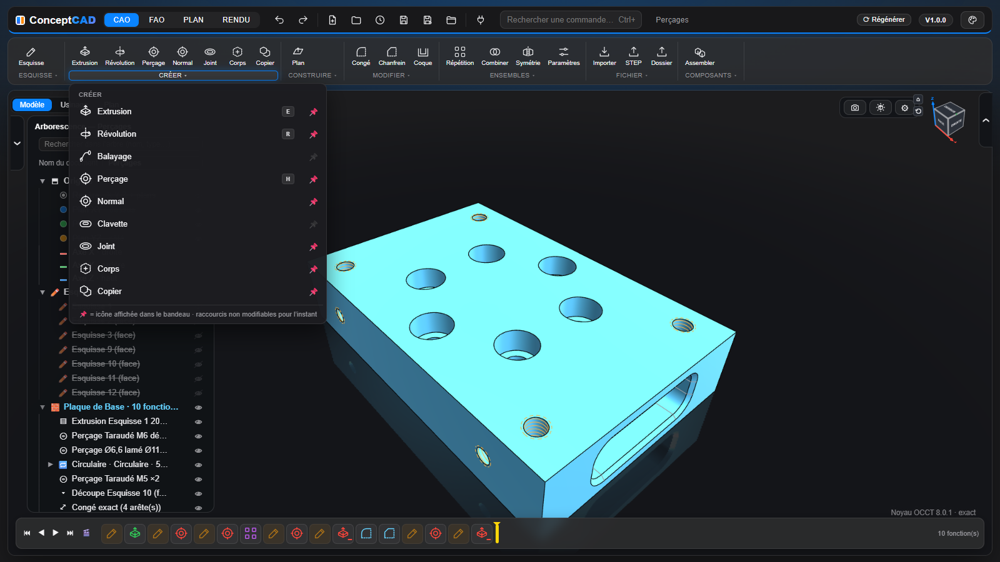
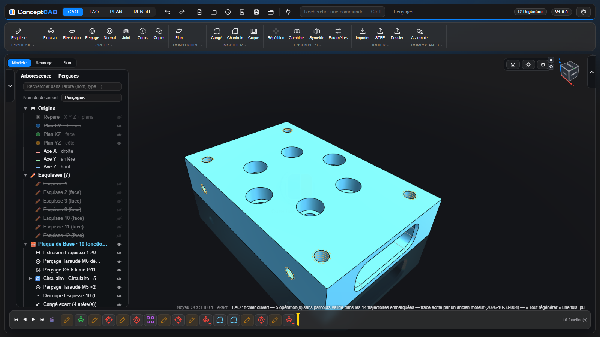
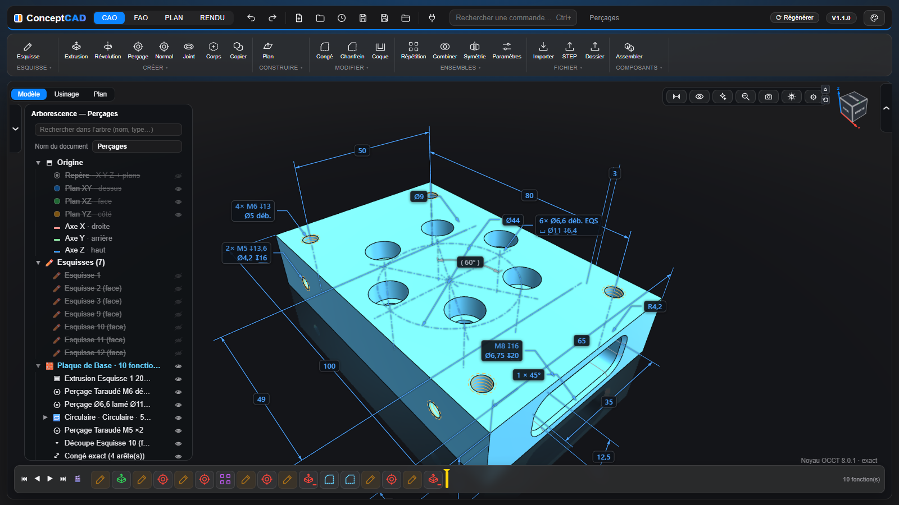
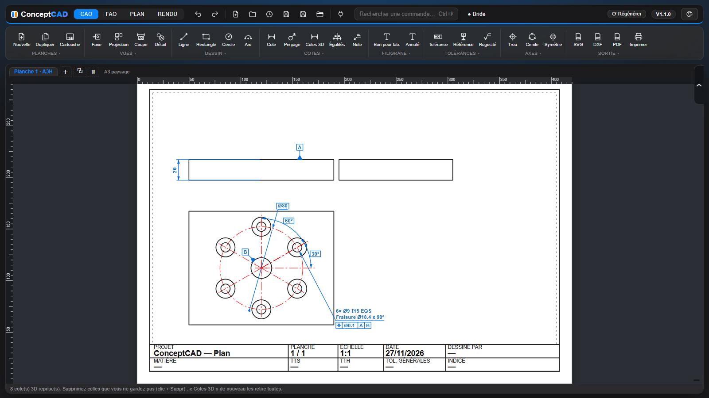
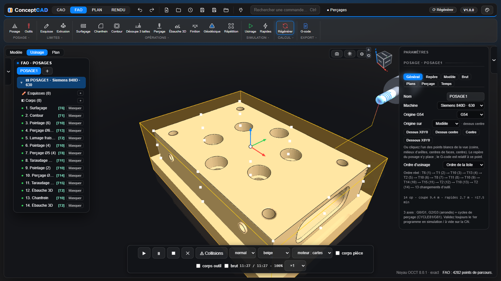

# ConceptCAD

**CAO paramétrique, assemblage, FAO, mise en plan et rendu, dans le navigateur.** Sur PC comme sur téléphone : rien à installer, pas de compte.

Ou installez-le depuis le site, dans Chrome ou Edge : icône d’installation de la barre du haut (ou de la barre d’adresse). Il a sa fenêtre et son icône, et il marche sans Internet ([Démarrage](docs/manuel/demarrage.md#installer-depuis-le-site)).

Version actuelle : **V1.2.4** · [Nouveautés](CHANGELOG.md) · [Manuel](docs/manuel/README.md) · [Exemples](Exemples)

> **V1.2.0 : quatre interfaces du futur.** Habitacle, Table holographique, Plan vivant et Goutte : quatre allures et dispositions nouvelles pour toute l’application (CAO, FAO, assemblage, PLAN), au choix dans le menu 🎨 › Interfaces du futur ([Apparence](docs/manuel/interface.md)).
>
> **V1.1.0 : les cotes 3D et la cotation automatique.** Chaque fonction pose ses cotes sur la pièce, et chaque cote pilote la pièce ([Cotation automatique](#cotes-3d-et-cotation-automatique)).

> **V1.0.0, la première version stable.** Les programmes d'usinage ont été essayés sur une vraie machine, une **Fagor 8065**. Les dernières versions n'ont corrigé que de tous petits défauts relevés pendant ces essais.

## De l'idée à la pièce usinée

Un seul logiciel et un seul fichier `.conceptcad` pour tout le parcours :
1. **CAO** : dessiner la pièce ;
2. **Assemblage** : la monter avec les autres ;
3. **FAO** : l'usiner ;
4. **PLAN** : la mettre en plan ;
5. **RENDU** : en faire une belle image.

Une cote change : le solide, les parcours d'outil et les plans suivent.

## Les menus

- **Bandeau du haut** :
  - les quatre espaces **CAO**, **FAO**, **PLAN** et **RENDU** ;
  - annuler, rétablir et les fichiers (nouveau, ouvrir, récents, enregistrer, dossier de projets) ;
  - la **recherche de commandes** (`Ctrl+K`), **Régénérer**, le nom du document et la version.
- **Ruban** propre à chaque espace, rangé en groupes comme dans Fusion 360 :
  - le **nom d'un groupe** (Créer ▾, Modifier ▾…) ouvre la liste de toutes ses fonctions, avec leur raccourci clavier ;
  - l'**épingle 📌** choisit celles qui restent aussi dans le ruban.
- **Arborescence** à gauche (Modèle, Usinage, Plan), **panneau Paramètres** flottant à droite, **timeline** en bas de la vue 3D.

| Espace | Groupes du ruban |
|---|---|
| **CAO** | Esquisse · Créer · Construire · Modifier · Ensembles · Fichier · Composants |
| **Assemblage** (bouton Assembler) | Modéliser · Composant · Occurrence · Relations · Répétition · Inspecter · Depuis corps · Normalisés · Aimants · Insérer |
| **FAO** | Posage · Limites · Opérations · Simulation · Calcul · Export |
| **PLAN** | Planches · Vues · Dessin · Cotes · Filigrane · Tolérances · Axes · Sortie |
| **RENDU** | Atelier en plein écran : moteur, ambiance, fond et sol, appareil photo, image finale |

Autres repères :
- **Partout** :
  - **Ctrl+Z / Ctrl+Y** annule et rétablit dans tous les espaces ;
  - un **clic long** liste tout ce qui est sous la souris, même caché.
- **Recalcul** : il se fait en arrière-plan, et la vue continue de tourner.
- **Apparence** :
  - **cinq thèmes** de couleurs ;
  - **quatre styles d'icônes** ;
  - des **fiches illustrées** qui s'animent au survol des icônes.

Manuel : [Interface](docs/manuel/interface.md) · [Souris, clavier et doigts](docs/manuel/raccourcis.md)

## CAO

- **Esquisses** contraintes et cotées : le bandeau de choix guide le tracé, comme dans Fusion 360. On y trouve lignes, rectangles, cercles, arcs tangents, oblongs, splines et **texte** (toutes les polices).
- **Paramètres et formules** (ƒx) dans tous les champs : CAO, FAO et plan.
- **Fonctions à historique** :
  - extrusion, révolution et balayage ;
  - **perçages** lisses, lamés, fraisés et taraudés, aussi sur un cylindre ;
  - rainure de clavette et **gorge de joint torique** automatiques ;
  - **congés exacts**, à rayon constant ou variable, et chanfreins ;
  - coque, dépouille, filetage, scission, déplacement ou suppression de faces ;
  - **répétitions** linéaires, en grille, circulaires, en symétrie ou suivant un profil.
- **Géométrie de construction** : plans, axes, points, repères.
- **Timeline** façon Fusion 360 : on glisse une fonction, on revient en arrière, et la pièce se recalcule en arrière-plan.
- **Cotes 3D pilotantes**, comme dans Inventor : on cote sur la pièce, la cote change l'esquisse, l'extrusion ou le perçage ; tolérances, références, cercles de trous à la norme ISO, et reprise dans la mise en plan.
- **La pièce qui propose** : après chaque fonction, la suite probable en une touche (« Même congé R4 sur les 3 autres coins », « Arrondir les 4 coins de la poche · R3 »), ou une demande écrite (« 4 trous M6 à 10 du bord »).
- **Lentilles** : une loupe posée sur la pièce montre, dessous seulement, l'intérieur, les passes de la FAO, le trait coté ou la vraie matière.
- **Échanges de fichiers** :
  - import **STEP**, **IGES** et STL ;
  - export STEP, STL, OBJ et **FreeCAD** ;
  - assemblage complet vers un dossier.

Manuel : [Esquisse](docs/manuel/esquisse.md) · [Fonctions 3D](docs/manuel/fonctions-3d.md) · [Cotes 3D](docs/manuel/cotes-3d.md) · [La pièce qui propose](docs/manuel/piece-propose.md) · [Lentilles](docs/manuel/lentilles.md) · [Fichiers](docs/manuel/fichiers.md)

## Cotes 3D et cotation automatique

- **Cotation automatique** : à chaque nouvelle fonction, ses cotes se posent toutes seules sur la pièce — hauteur d'une extrusion, trou entier d'un perçage (« 6× Ø9 ↧15 EQS / ⌵Ø18,4 × 90° »), rayon d'un congé, Ø de perçage et angles d'une répétition circulaire, cotes reprises de l'esquisse. Sur une pièce déjà faite : clic droit sur une fonction → « 📐 Poser ses cotes 3D ».
- **Les cotes pilotent la pièce**, comme dans Inventor : double-clic sur la valeur, on tape un autre nombre, l'esquisse ou la fonction change et la pièce glisse vers sa nouvelle forme. Entre parenthèses : cote de référence, qui ne pilote rien.
- **Tout ce que fait la mise en plan**, sur la 3D : tolérances, références A / B, rugosité, cadres de tolérance géométrique, cote encadrée ou d'inspection, cercles de trous à la norme ISO (EQS, ⌖ Localisation).
- **Sur le plan**, un clic (« Cotes 3D ») : les cotes arrivent dans les vues où elles se lisent, rangées sans se chevaucher.

Manuel : [Cotes 3D](docs/manuel/cotes-3d.md)

## Assemblage

- **Tout est composant**, comme dans Fusion 360 : pièces, sous-ensembles, fichiers liés ou dérivés, à n'importe quelle profondeur.
- **Relations entre faces** : face contre face, cylindre dans cylindre, tangente, angle, parallèle. Elles sont gardées dans un historique d'étapes qu'on peut modifier.
- **Dessiner d'après les autres pièces** :
  - projeter leurs arêtes dans une esquisse ;
  - extruder ou percer **jusqu'à** une de leurs faces, arêtes ou sommets, avec un décalage + / −.
- **Normalisés**, posés d'un clic dans tous les trous identiques :
  - vis ISO et ANSI, bouchons, goupilles, clavettes, rondelles ;
  - douilles Ensat, joints toriques, quadrilobes et racleurs ;
  - **engrenages** à vraie développante : roue, couronne, crémaillère, paire au bon entraxe.
- **Aimants** réels avec leurs lignes de champ.
- **Liaisons animées**, interférences, masse et centre de gravité.

Manuel : [Assemblage](docs/manuel/assemblage.md)

## FAO

- **Posages** : repère d'usinage sur un des 27 points du brut ou du modèle. Brut en boîte, en cylindre ou en vrai corps. Usinage **3+2**.
- **Opérations** :
  - Surfaçage, Chanfrein, Contour et Découpe 3 tailles ;
  - **Perçage**, avec la gamme automatique des trous reconnus sur le modèle ;
  - **Ébauche 3D** (Escargot, Contours, brut restant), **Finition** à crêtes constantes et Géodésique ;
  - **Répétition** d'opérations.
- **Liaisons soignées** :
  - entrées et sorties en arc ;
  - congés en **G2 / G3** ;
  - la fraise reste en bas d'un niveau à l'autre ;
  - plus de rapides dans le vide.
- **Simulation** de la matière enlevée, avec l'outil réel et le vrai brut, contrôle des collisions et temps estimé.
- **G-code Siemens 840D et Fagor 8065**, avec usinage grande vitesse HSC sur la Fagor. Les essais sur machine ont été faits sur une **Fagor 8065**.
- Les calculs se répartissent sur **tous les cœurs** du PC : l'écran ne se fige pas.

Manuel : [FAO](docs/manuel/fao.md)

## PLAN

- **Planches** A4 à A0, cartouche dessiné, nomenclature.
- **Vues aux arêtes exactes**, calculées sur plusieurs cœurs : face, projections, ISO, caméra, auxiliaire, **coupe** (même brisée), détail, coupe locale. On peut aussi importer un DXF.
- **Cotes qui suivent la pièce** : Ø, longueurs, angles, perçages cotés automatiquement, ordonnées, notes.
- **Tolérances et marques** :
  - tolérances géométriques ISO 1101 et références ISO 5459 ;
  - états de surface ;
  - filigranes « Bon pour fabrication » ou « Annulé ».
- **Sorties** PDF, DXF, SVG et impression.

Manuel : [PLAN](docs/manuel/plan.md)

## RENDU

- Images réalistes en 1920×1080 ou en 4K.
- **Deux moteurs** : rapide, ou lancer de rayons (reflets entre pièces, vrai verre).
- Matériaux choisis au clic droit sur chaque pièce, reliefs (brossé, sablé, moleté), patine, ambiances, 80 sols, appareil photo réglable.
- **Rendu direct** : la vue CAO ou FAO prend les matériaux de l'atelier, en temps réel.

Manuel : [RENDU](docs/manuel/rendu.md)

## Faire dessiner par l'IA

Branché sur Claude (MCP), ConceptCAD dessine la pièce qu'on lui décrit, par exemple « une bride 80 × 50 × 12, congés R6, quatre trous lamés M6 ». Il se sert des mêmes fonctions que vous : tout reste modifiable à la souris, et un seul `Ctrl+Z` annule la demande.

Manuel : [Scripts et pilotage par Claude (MCP)](docs/manuel/scripts-mcp.md)

## Sur téléphone et tablette

Sur un petit écran tactile, ConceptCAD passe tout seul en **interface téléphone** :
- vue 3D plein écran ;
- panneau translucide ;
- gestes au doigt : pincer pour zoomer, glisser à deux doigts pour déplacer.

C'est le même fichier `.conceptcad` que sur PC.

Manuel : [Téléphone et tablette](docs/manuel/telephone.md)

## Choisir sa version

C'est le même logiciel partout, et les fichiers passent d'une version à l'autre.

| Version | Pour qui | Lien |
|---|---|---|
| **En ligne** | Essayer tout de suite, sur PC ou téléphone | [Ouvrir ConceptCAD](https://bobfredgard.github.io/ConceptCAD/) |
| **Autonome** | PC sans Internet : un seul fichier, ouvert par double-clic | [Télécharger](https://www.dropbox.com/scl/fi/sne7f5a9y8dr659b2xrow/ConceptCAD-autonome.html?rlkey=fgd0w1r5816ake50vxtd4fnuj&dl=0) (≈ 23 Mo) |
| **Windows** | Vraies fenêtres Ouvrir et Enregistrer, double-clic sur un fichier | [Installateur](https://github.com/BobFredGard/ConceptCAD/releases/latest/download/ConceptCAD-Windows-setup.exe) (≈ 22 Mo) |
| **Mac** | macOS 12 ou plus récent | [DMG](https://github.com/BobFredGard/ConceptCAD/releases/latest/download/ConceptCAD-Mac.dmg) (≈ 45 Mo) |

Les applications Windows et Mac proposent d'elles-mêmes la mise à jour quand une nouvelle version sort. Elles ne sont pas signées : le système peut afficher un avertissement au premier lancement. Détails et points pas encore vérifiés : [Démarrage](docs/manuel/demarrage.md).

## Premiers pas

1. Télécharger l'exemple [Perçages.conceptcad](https://github.com/BobFredGard/ConceptCAD/raw/main/Exemples/Per%C3%A7ages.conceptcad) : une plaque usinée complète, avec sa planche.
2. [Lancer ConceptCAD](https://bobfredgard.github.io/ConceptCAD/). Le premier lancement télécharge le noyau de calcul (≈ 43 Mo, de préférence en Wi-Fi).
3. Ouvrir le fichier (`Ctrl+O`).
4. Passer d'un espace à l'autre dans le bandeau du haut : **CAO**, **FAO**, **PLAN**, **RENDU**.
5. Cliquer le nom d'un groupe du ruban (**Créer ▾**, **Opérations ▾**…) pour voir toutes ses fonctions.
6. Modifier un paramètre (bouton **ƒx**) et regarder la pièce, les parcours et la planche suivre.

D'autres projets à ouvrir sont dans le dossier [Exemples](Exemples) : Crochet, Support Pédale, Axe, Engrenages, Cavité Usinage, Malaxeur Retard, Découpe 3 tailles.

## Le manuel

| Pour démarrer | Concevoir | Fabriquer et montrer | Aller plus loin |
|---|---|---|---|
| [Démarrage](docs/manuel/demarrage.md) | [Esquisse](docs/manuel/esquisse.md) | [FAO](docs/manuel/fao.md) | [Scripts et MCP](docs/manuel/scripts-mcp.md) |
| [Interface](docs/manuel/interface.md) | [Fonctions 3D](docs/manuel/fonctions-3d.md) | [PLAN](docs/manuel/plan.md) | [Développement](docs/manuel/developpement.md) |
| [Téléphone et tablette](docs/manuel/telephone.md) | [Assemblage](docs/manuel/assemblage.md) | [RENDU](docs/manuel/rendu.md) | [Journal des modifications](CHANGELOG.md) |
| [Souris, clavier et doigts](docs/manuel/raccourcis.md) | [Fichiers](docs/manuel/fichiers.md) | | |

## Sous le capot

- **Noyau géométrique exact** : OpenCascade 8, compilé en WebAssembly par nos soins. Il est multicœur quand le navigateur et le PC le permettent.
- **Affichage** : three.js. La simulation et le rendu tournent sur la carte graphique (NVIDIA, AMD, Apple).
- **Calculs FAO et mise en plan** répartis sur tous les cœurs du processeur.
- Pour lancer depuis les sources, comprendre le dépôt ou livrer une version : [Développement](docs/manuel/developpement.md).

## Licences

- Code : **ISC** (voir `package.json`).
- `threejs/` : three.js 0.187 (empaqueté en script classique par `tools/three-entree.mjs`) et OrbitControls sous **MIT**, CSG.js.
- `threejs/rendu-rayons.js` : three.js (même version, copie isolée), three-mesh-bvh, three-gpu-pathtracer et fflate, sous **MIT**.
- `occt/` : OpenCascade Technology sous **LGPL**.

---

*Anciennement **MiniFusion** (renommé en V0.33.0).*
