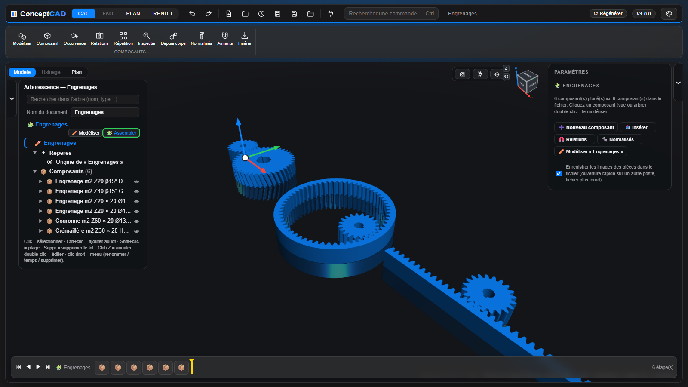

[ConceptCAD](../../README.md) › [Manuel](README.md) › Assemblage

# Assemblage

Comme dans Fusion 360, **tout est composant** : le fichier est le composant racine, ses enfants sont des pièces complètes, à n'importe quelle profondeur.
- **Arbre unifié** : pièce et composants dans une seule arborescence, avec recherche et glisser-déposer ; sélection multiple dans l'arbre (`Ctrl+clic`, `Shift+clic` = plage) aussi en mode Assembler.
- **Modéliser** le composant actif (le reste de l'assemblage affiché autour) ou **Assembler** ses enfants (manipulateur, pas de 1 mm et 5°). Dans les deux modes, la vue tourne autour du composant visé.
- **Projeter les arêtes des autres pièces** : en modélisant une pièce (double-clic), une esquisse et l'outil **⧉ Projeter** (touche P) attrapent aussi les arêtes des autres pièces visibles de l'assemblage, pièces issues d'un STEP comprises. L'arête projetée suit la pièce visée quand elle bouge ou change. Ne sont pas proposées : les pièces masquées et les autres occurrences de la pièce en cours.
- **Appui long avec ⧉ Projeter** : quand l'arête d'une autre pièce est superposée à une arête de la pièce en cours (même tracé vu depuis le plan), le clic prend celle de la pièce. Restez appuyé une demi-seconde sans bouger : une liste montre tout ce qui est sous le clic, arêtes de la pièce (« cette pièce ») et des autres pièces (« pièce « Socle:1 » »), avec leur écart au plan ; le survol allume l'arête, un clic la projette.
- **Jusqu'à une autre pièce** : en modélisant une pièce, l'étendue **Jusqu'à la face** de l'**extrusion** et la fin **Jusqu'à la face** du **perçage** (fin du trou, longueur filetée) acceptent aussi une **face plane**, une **arête** ou un **sommet** d'une autre pièce visible. Le survol l'allume en orange et donne son nom (« Face · Socle:1 »). Une arête parallèle au plan de départ arrête la fonction à sa hauteur ; sur une arête en biais, le clic prend son sommet le plus proche. Pas besoin de fonction avant : la première extrusion d'une pièce peut monter jusqu'à sa voisine.
  - **Décalage** (mm) : `+1` va 1 mm plus loin que la cible, `-1` s'arrête 1 mm avant. Il reste quand on change de cible ; un décalage qui ferait repartir l'extrusion de l'autre côté de son esquisse est refusé. Il sert aussi pour une face de la pièce elle-même.
  - La fonction **suit** l'autre pièce quand elle bouge ou change, même si la pièce qui la porte n'est pas celle qu'on modélise. Si la face ou l'arête disparaît, la dernière distance est gardée et la fenêtre l'indique par ⚠.
- **FAO** permise seulement quand une **pièce** est active (pas en mode Assembler).
- **Composant**, **Occurrence**, **Insérer** un autre fichier, **Depuis corps** pour convertir une pièce multicorps sans rien remodéliser.
- **Normalisés** : vraies fonctions (révolution, six pans creux), avec aperçu coté.
  - **Vis** ISO 4762 / ISO 10642 (pas gros par défaut, pas fins au choix), ANSI SHCS / FHCS 82° (UNC ou UNF).
  - **Bouchons** six pans creux DIN 906, DIN 908 et NPTF.
  - **Goupilles** ISO 2338, 8734, 2339, 8752 et ANSI (dowel, spring).
  - **Clavettes** ISO 773 formes A, B, C.
  - **Joints toriques** ISO 3601-1 classe A (AS568) et **quadrilobes** (X-ring) : les cinq sections 1,78 – 2,62 – 3,53 – 5,33 – 6,99 et tous leurs diamètres intérieurs.
  - **Joints racleurs** de tige, logement ISO 6195 type A : tiges de 4 à 360 mm (désignation tige × Ø logement × largeur).
  - **Rondelles** plates ISO 7089, 7090 (chanfreinée), 7092 (étroite), 7093-1 (large), Grower DIN 127 B, ANSI B18.22.1 Type A (séries N et W) et lock washers B18.21.1.
  - **Douilles autotaraudeuses** Ensat 302 (douille à fente de coupe) : métrique M2 à M20 (et M6 courte), pouces #4 à 5/8" en UNC ou UNF. Aucune norme ISO ni ANSI n'existe : cotes de la norme d'usine Ensat 302, reprise par tous les fabricants. Corps fileté, taraudage débouchant fraisé, fente ; la fiche donne le perçage conseillé et la profondeur mini du trou borgne. Posée « Sur des trous », 0,1 mm sous la surface.
  - **Engrenages** à vraie développante (ISO 53, ISO 21771) : roue, couronne ou crémaillère, denture droite ou hélicoïdale, déport, alésage et rainure de clavette. Sous-coupe, dent en pointe et autres défauts sont signalés.
  - **Paire d'engrenages** : pignon avec roue, couronne ou crémaillère, posés dents logées au bon entraxe, avec le jeu choisi. Entraxe, rapport de conduite et interférences affichés. Les pièces restent libres (pas de lien de mouvement) ; la résistance des dents n'est pas calculée. L'export STEP se fait pièce par pièce. Exemple : `Exemples/Engrenages.conceptcad`.
  - **Sur des trous** : un clic sur un trou pose la pièce dans tous les trous identiques (simples, lamés, fraisés), en liaison rigide qui suit les trous (vis FHC 0,2 mm sous la surface, goupilles par leur centre : milieu du trou, arête haute ou basse, au plus court du clic).
  - **Sur des oblongs** (rondelles) : un clic dans un trou oblong pose une rondelle sur sa face, sur tous les oblongs identiques : dans l'axe du trou rond de la pièce du dessous (elle suit ce trou), ou au centre de l'oblong s'il n'y en a pas ou si on le choisit.
  - **Dans une rainure** : une clavette se pose au fond d'une rainure (fermée ou débouchante), par le centre de face ou contre un bout rond, et toutes les rainures identiques sont équipées.
  - **Modifier…** (propriétés ou clic droit) rouvre la fenêtre sur la pièce : toutes ses occurrences, ou celle-ci seulement.
- **Aimants** : bibliothèque d'aimants réels, avec leurs caractéristiques, montrés en deux moitiés (pôle nord rouge, pôle sud vert).
  - Formes : disques, cylindres, cubes, pavés, anneaux, cônes tronqués, disques aimantés en travers, disques et pavés à visser à trous fraisés.
  - Clic droit sur un aimant posé : afficher ou masquer ses lignes de champ 3D, calculées dans l'air. Avec plusieurs aimants posés, les lignes suivent leur champ additionné (attraction, répulsion).
- **Composants liés** à un fichier du dossier de projets : édition sur place, mise à jour, conflits gérés. **📦 Dossier** (Fichier → Exporter) copie l'assemblage et tous ses fichiers liés, avec les programmes CN, dans le dossier de son choix.
  - Un composant lié porte le nom de son fichier (MERLIN-39-001). Enregistré pendant qu'une de ses pièces est en cours de modification, l'assemblage se rouvre dans cette pièce et c'est l'assemblage qui prend le nom du fichier, jamais la pièce (V0.99.83). Un assemblage enregistré avant V0.99.83 dont une pièce liée portait le nom de l'assemblage reprend tout seul, à l'ouverture, le nom de son fichier.
- **Dérivée** (bouton **🔗 Dériver**) : paramètres et corps d'un autre fichier du dossier de projets, qui suivent leur source quand elle change (lien à sens unique : la source n'est jamais réécrite). Un paramètre dérivé se modifie dans sa source ; un corps dérivé reste modifiable dans le fichier qui le reçoit, ses fonctions ajoutées survivent aux mises à jour, et il peut servir d'outil à soustraire avec **Combiner**.
  - Paramètres dérivés **utilisés ou non** : dans la liste complète **ƒx** et la mini-liste, un paramètre dérivé que rien n'utilise dans le modèle (paramètre, cote, fonction 3D, FAO, mise en plan, assemblage, configuration) est grisé, avec « non utilisé ». Dans la section **🔗 Dérivées**, chaque source indique combien sont utilisés, et **🧹 Retirer les N non utilisés** les enlève tous d'un coup (Ctrl+Z les rétablit). Ils restent dans la source : « + Dériver depuis un fichier… » les reprend ; les paramètres ajoutés ensuite à la source n'arrivent plus d'eux-mêmes.
  - Seules les valeurs **nommées** sont proposées, **décochées** au départ : cochez celles à partager, ou **Tout cocher** / **Tout décocher** (V0.99.21).
- **Répétition** de composants : linéaire (1 ou 2 directions), circulaire, symétrie, suivant un profil. Une même répétition peut porter **plusieurs composants** : panneau ouvert, un clic sur un composant (vue ou arbre) l'ajoute ou le retire, ✕ dans la liste du panneau pour le retirer.
- **Paramètres dans les champs de l'assemblage** : Aligner, Placement et Répétition acceptent un paramètre ou une expression (`pas_SM`, `-L/2`) et **gardent le lien** : le paramètre change, la pièce se replace et la répétition se refait. Le lien est gardé dans le fichier.
- **Ouverture rapide** : l'image mesurable de chaque pièce est gardée d'une ouverture à l'autre, aussi pour une pièce qui contient une forme importée ou dérivée ; une soustraction de corps dérivé est là dès le premier affichage. Les faces qui servent de points d'accroche aux alignements sont gardées avec elle : un assemblage aligné sur les faces de ses pièces se rouvre sans les recalculer. Les images des pièces sont enregistrées d'office dans le fichier de l'assemblage (case à décocher dans ses propriétés pour un fichier plus léger) ; un composant lié dont le fichier porte l'image de sa pièce est servi depuis ce fichier, sans recalcul.
- **Relations** (🧲, comme « Créer les relations » de Fusion) : un clic sur une face de la pièce à déplacer, puis sur la face où la poser — la pièce s'y colle aussitôt. **Coïncidente** (face contre face, ou affleurante avec ⇅ Inverser ; cylindre dans cylindre ; axe dans un plan), **Angle**, **Parallèle**, **Tangente** (cylindre contre une face ou contre un autre cylindre). Les **plans des repères** (XY, XZ, YZ de l'origine et des repères de construction) se cliquent comme des faces. Décalage ou angle réglable, ＋ pour cumuler plusieurs relations sur la même pièce ; le panneau indique les degrés de liberté restants, que le manipulateur déplace encore. Les relations suivent les pièces quand elles changent, sont gardées dans le fichier et s'annulent par Ctrl+Z.
- **Arêtes et sommets dans les relations** : en plus des faces, un clic près d’une **arête** (droite ou cercle) ou d’un **sommet** les prend, pièces importées comprises (STEP, IGES, quelle que soit la forme de la face). Arête droite = un axe, cercle = son centre et son axe, sommet = un point. Coïncidente : sommet sur sommet, sur une face ou sur une arête ; cercle sur cercle (concentriques, même plan) ou dans un plan ; arête dans un plan. Angle et Parallèle marchent sur les arêtes ; un sommet n’a que Coïncidente.
- **Plan milieu** (Relations, bouton ▤ à côté de « Pièce déplacée » ou de « Cible ») : deux clics sur deux faces planes parallèles d'une même pièce donnent le plan à mi-chemin, utilisable comme une face. Une pièce tenue par une liaison ou fixée propose « Supprimer la liaison et poser cette face » (Annuler la remet). Le panneau Relations a aussi Distance X / Y / Z et Angle X / Y / Z : la pièce bouge le long de ce que les relations laissent libre.
- **Historique de l'assemblage** (barre en bas de la vue en mode Assembler) : une étape par insertion, liaison, relation, répétition ou déplacement, dans l'ordre de création. Glisser le marqueur ⏱ (ou ⏮ ◀ ▶ ⏭) pour revoir l'assemblage étape par étape ; clic = sélectionner la pièce, double-clic sur une relation = la modifier. Toute modification remet le marqueur en fin.
  Clic sur une relation ou une répétition : sa modification s'ouvre. **Suppr** supprime l'étape choisie, clic droit : Modifier / Supprimer (Ctrl+Z la rend).
  L'insertion d'une **pièce normalisée** y a le dessin de la pièce (vis à tête cylindrique ou fraisée, bouchon, goupille, clavette, joint, rondelle, douille, engrenage, aimant…) au lieu du cube 📦 ; le même dessin la montre dans l'arborescence, dans l'en-tête de son panneau et sur les onglets de la fenêtre « Composants normalisés ».
- **Couleurs d'un STEP à plusieurs corps** : à l'import, chaque corps prend la couleur enregistrée dans le fichier. Pour changer la couleur d'un seul corps : double-clic sur la pièce pour la modéliser, puis clic droit sur le corps (vue 3D ou arborescence du STEP) → 🎨 Couleur. La couleur suit en assemblage.
- **Position de départ** : le panneau d'une pièce libre montre Distance X / Y / Z et Angle X / Y / Z depuis sa position quand elle a été choisie (ou insérée) ; le manipulateur les met à jour, « ↺ Position de départ » y revient.
- **Aligner** un repère ou un **point d'accroche** (centre et points cardinaux d'une face, axe d'un cylindre, centre d'un cercle) sur un autre composant, de façon associative.
- **Liaisons** : rigide, pivot, glissière, pivot glissant, plan, rotule, avec limites, curseurs et animation.
- **Références entre composants** : faces, arêtes, sommets, plans et axes d'un autre composant servent de références, et suivent ses changements.
- **Inspecter** : propriétés physiques (volume, masse, centre de gravité) et interférences.
- **Apparence de rendu** par pièce au clic droit, appliquée d'un coup à toutes les occurrences d'un composant (visserie).

---

[← Fichiers](fichiers.md) · [Sommaire du manuel](README.md) · [FAO →](fao.md)
