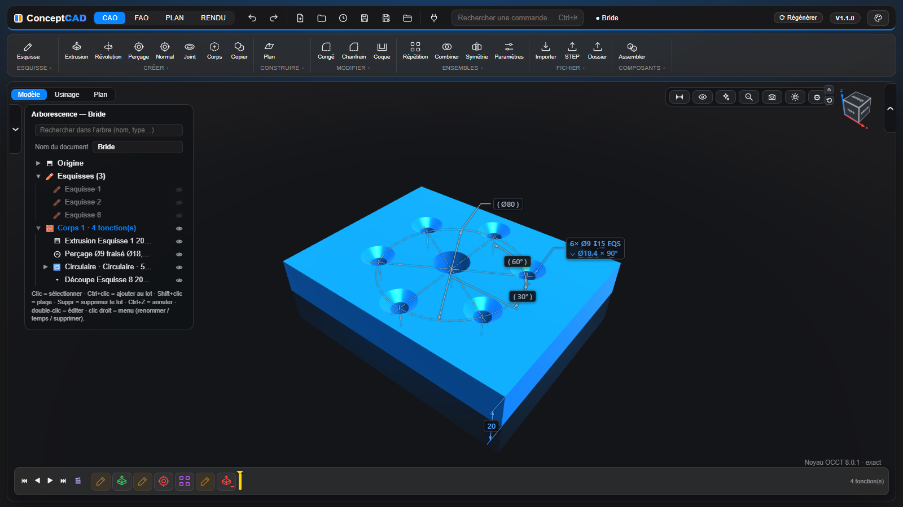
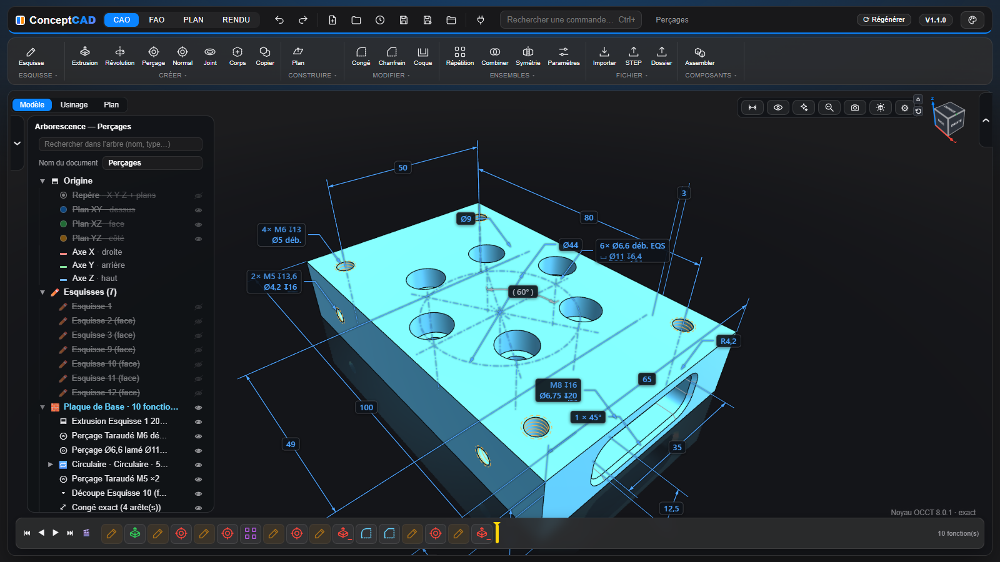
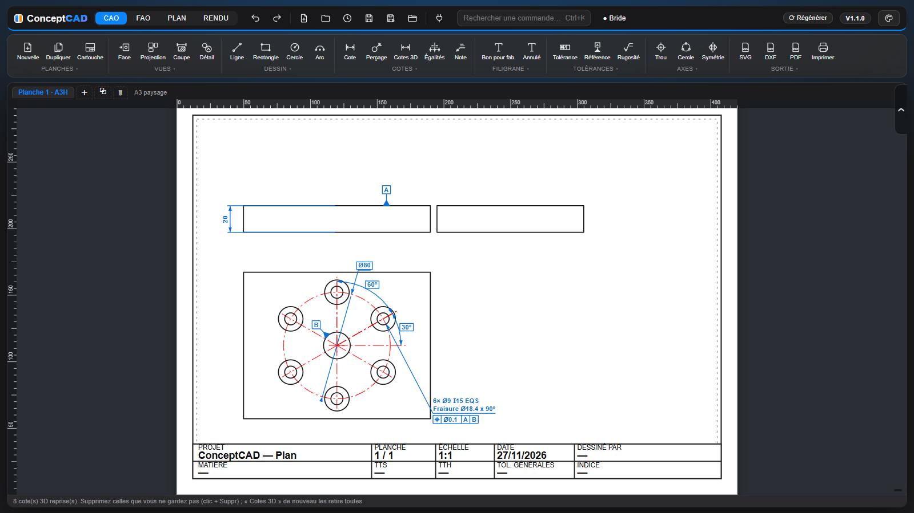

[ConceptCAD](../../README.md) › [Manuel](README.md) › Cotes 3D

# Cotes 3D

On dessine l'esquisse comme d'habitude, puis on cote **sur la pièce 3D**, comme dans Inventor. Une cote 3D lit toujours sa valeur sur la pièce. Une cote **pilotante** change en plus la pièce quand on tape une autre valeur : elle modifie pour cela une cote d'esquisse ou un réglage de fonction. Les cotes d'esquisse restent dans l'esquisse ; les deux sortes vivent ensemble.

## Cotation automatique

**On ne pose presque aucune cote à la main.** À chaque nouvelle fonction (extrusion, perçage, congé, répétition…), ConceptCAD pose tout seul sur la pièce les cotes qui la décrivent, quelques instants après le calcul exact de la pièce (jamais pendant que la fenêtre de l'extrusion est ouverte et que la pièce bouge encore).



Ce qu'il faut savoir :

- **Chaque cote lit sa valeur sur la pièce**, jamais une copie : si la pièce change, la cote change avec elle.
- **Elle pilote** ce qui l'a faite : double-clic sur la valeur, on tape un autre nombre, la pièce suit (voir *Changer une valeur*). La cote modifie pour cela la cote d'esquisse ou le réglage de la fonction.
- **Entre parenthèses**, « (60°) », c'est une cote **de référence** : elle renseigne mais ne pilote rien (rien ne la fait bouger, ou elle découle d'un autre réglage — l'angle entre 6 trous sur un tour complet vient du nombre de trous). **Encadrée**, « [Ø80] », c'est une cote théoriquement exacte (ISO 1101), posée par la *Localisation ISO*.
- Une cote d'esquisse n'est reprise que si la pièce mesure exactement la même valeur ; **rien n'est posé deux fois** pour le même réglage.
- Les cotes se placent **à côté de leurs faces**, couchées le long des axes de la pièce ; on les glisse ensuite où l'on veut (elles restent accrochées à leurs faces).

Ce qui se pose, fonction par fonction :

- **Extrusion** : sa hauteur (dessus ↔ dessous ; pour une découpe, fond ↔ face de départ). Le dessus d'un bossage rond se reconnaît aussi.
- **Perçage** : la cote Ø du trou entier (« 2× Ø8 ↧12 »).
- **Congé** : un rayon par valeur, qui pilote toutes les arêtes de ce rayon.
- **Chanfrein** : « 3 × 45° » par distance, qui pilote toutes les arêtes de cette distance ; à deux distances, « 3 × 5 » (ou « 5 × 3 » selon le côté lu : la 2e distance se pilote alors) ; distance + angle, « 3 × 30° » (la cote lit le côté de la distance, qui se pilote ; l'angle suit). Posée à la main sur un tel chanfrein, la cote lit aussi ce côté.
- **Coque** : l'épaisseur, entre une face et sa face intérieure (le dessus d'abord).
- **Révolution** de moins de 360° : l'angle entre sa face de départ et sa face de fin (jusqu'à 359°, l'arc fait le grand tour au-delà de 180°).
- **Répétition linéaire** : le pas, entre la source et le premier exemplaire (entraxe de deux cylindres de préférence) ; sur deux directions, aussi le **pas 2**.
- **Répétition circulaire** : le **Ø de perçage** et l'**angle du 1er trou depuis l'axe horizontal** (s'il n'est pas sur un axe ; voir *Cercle de trous (ISO)*), puis le **pas angulaire** entre la source et le premier exemplaire (de référence, entre parenthèses, sur un tour complet) — pour des trous, l'angle autour de l'axe de la répétition, avec l'arc qui passe par les centres des trous (60° pour 6 trous). Changer ce pas change l'angle de la répétition (6 trous à 45° couvrent 225°). À la main : coter l'entraxe de deux trous de la répétition, puis **Angle autour de l'axe** dans la bande « Qu'est-ce qui bouge ? » — la cote devient l'angle entre ces deux trous (120° entre la source et le 2e exemplaire) et pilote l'angle de la répétition.
- **Cotes de l'esquisse**, reprises sur la pièce : écart de deux flancs parallèles, Ø d'un cercle, entraxe, axe ↔ flanc. La cote 3D pilote la cote d'esquisse ; elle n'est gardée que si elle mesure exactement la même valeur.

**Une pièce déjà faite** (fichier ouvert, pièce d'avant V1.0.20) : clic droit sur une fonction dans l'arbre → **📐 Poser ses cotes 3D** ; à refaire sur chaque fonction voulue. Sur l'exemple *Perçages*, les 10 fonctions donnent 19 cotes : hauteurs, entraxes, Ø de perçage, tous les trous avec leur profondeur, leur lamage ou leur filetage, le congé R4,2 et le chanfrein 1 × 45°.



**Couper l'automatique** : clic droit sur une cote → **Cotes 3D posées à chaque création** (coché = en marche) ; le choix est gardé sur ce poste. Les cotes déjà posées restent. **Trop de cotes** : l'œil de la barre de vue (ou `Maj+D`) les cache toutes, le clic droit cache une cote ou toutes celles d'une fonction, `Suppr` en retire une.

**Sur le plan**, la cotation automatique continue : onglet PLAN, bouton **Cotes 3D**, les cotes de la pièce arrivent dans les vues où elles se lisent en vraie grandeur, rangées sans se chevaucher (voir *Dans la mise en plan*).

La vue complète (recadrage, Iso) englobe les cotes 3D visibles.

## Poser une cote

- **Outil** : bouton « cote » de la barre de vue (à gauche de l'étincelle), ou touche `D` hors esquisse. `Échap` défait le premier clic, puis ferme l'outil.
- **Entre deux faces** : clic sur une face, puis sur une face parallèle (deux plans face à face, deux trous ou deux cylindres pour un entraxe, un trou et une face).
- **Un angle** : clic sur deux faces planes qui ne sont pas parallèles. L'arc se pose sur l'arête commune ; **↻ Autre face** donne l'angle supplémentaire (110° au lieu de 70°).
- **Un Ø** : clic sur un trou ou un cylindre, puis **Coter le Ø** dans la bande (ou `Entrée`). Dans la carte, **⊙ Dans le plan** couche la cote dans le plan du cercle (trait de diamètre d'un bord à l'autre, flèches sur le bord, ↻ le tourne d'un quart de tour) ; **↗ Déportée** revient à la cote déportée.
- **Une référence A, B…** : clic sur une face, puis **Référence A** dans la bande. La lettre suivante libre est proposée ; la carte permet d'en changer (un doublon est signalé).
- **Une rugosité** : clic sur une face, puis **Rugosité**. Dans la carte : Ra, Rz…, la valeur (boutons 0,8 · 1,6 · 3,2 · 6,3), le procédé (enlèvement de matière exigé, interdit, tout procédé) et un texte. La rugosité suivante reprend les mêmes réglages.
- **Des arêtes** : une arête à moins de 6 px du clic passe avant la face (même si l'affichage des arêtes est coupé) ; elle s'allume en orange.
- **Des sommets** : un clic à moins de 9 px du bout d'une arête prend le **sommet** (un point orange). Sommet ↔ sommet donne la vraie distance ; sommet ↔ face plane, la distance au plan ; sommet ↔ trou ou arête circulaire, la distance à l'axe ; sommet ↔ arête droite, la distance à la droite.
- **Une arête et une face** : arête droite ↔ face plane parallèle (distance), arête droite ↔ cylindre d'axe parallèle (distance à l'axe), arête circulaire ↔ face (plan parallèle : écart des plans ; axe parallèle à la face : distance de l'axe), arête circulaire ↔ cylindre (entraxe). Dans les deux sens : la face d'abord ou l'arête d'abord.
- **Des ordonnées** : clic sur la face (ou le trou) du zéro, puis **Ordonnées** dans la bande ; chaque clic suivant sur une face ou un trou ajoute une valeur de la famille, `Échap` termine. Le sens de mesure est celui de la normale du zéro (ou de la 1re face, ou, entre deux trous, l'axe de la pièce le plus proche) ; une face qui n'est pas perpendiculaire à ce sens est refusée. Chaque valeur pilote le premier réglage libre, sinon elle est de référence.
  - arête circulaire seule → **Coter le Ø** ; arc (coin arrondi, congé) → **Coter le rayon** (R, qui peut piloter le congé) ;
  - deux arêtes droites parallèles → leur écart ;
  - deux arêtes circulaires → l'entraxe, mesuré entre les axes et dessiné dans leur sens (comme deux trous) ;
  - une arête circulaire et une arête droite → axe ↔ arête, mesuré dans le plan du cercle.
  Une arête se cote avec une autre arête, pas avec une face.
- Les faces et les arêtes sont retenues par leur nom (une arête = la paire de faces qui la porte) : la cote les suit quand la pièce change.

## Qu'est-ce qui bouge ?

Juste après la pose, une bande liste les réglages qui changent cette cote, du plus récent au plus ancien :

- **Distance d'une extrusion ou d'une découpe** : dessus ou fond de la fonction.
- **Cote de l'esquisse** : côtés d'une extrusion. Chaque cote de l'esquisse est essayée sur une copie de l'esquisse et gardée si elle déplace ce que l'on cote.
- **Fonction Perçage** :
  - le Ø qui vaut la cote (perçage, lamage, alésage, avant-trou, fraisure) ;
  - la profondeur du perçage, ou celle du lamage, de l'alésage ou de l'avant-trou ;
  - l'**entraxe** de deux trous : la cote de l'esquisse qui place leurs centres de perçage ;
- **Cote d'angle de l'esquisse** : pour une cote d'angle.

Un clic choisit le réglage, puis la valeur se tape tout de suite à la place de la cote. **Cote de référence** garde une cote qui ne fait que lire, entre parenthèses et en gris.

Un réglage n'est piloté que par **une seule** cote 3D. S'il est déjà tenu, la bande propose « À la place de 60 : … », et l'autre cote passe en référence.

## Changer une valeur

- Double-clic sur la cote, ou clic sur une cote déjà choisie, ou `Entrée` : on tape la nouvelle valeur (virgule acceptée), puis `Entrée`.
- La pièce est rejouée jusqu'à ce que la cote vaille la valeur tapée, à 1/10 000 mm près. Il faut en général 1 ou 2 rejeux.
- La pièce **glisse** ensuite de l'ancienne forme à la nouvelle en 0,45 s, image par image, sans rejeu supplémentaire (les arêtes réapparaissent à l'arrivée). Les points d'avant et d'après sont appariés face par face (par le nom de la face), chaque sommet à la même place relative dans sa face : le noyau range et coupe les triangles autrement d'un rejeu à l'autre. Si une face change de forme (le coin d'un congé qui grandit), si une face apparaît ou disparaît, ou si un point sauterait plus loin que le réglage ne bouge, quelques vrais rejeux intermédiaires prennent le relais, sauf si un rejeu prend plus de 0,35 s : jamais de fente ni de triangle mélangé. Si Windows demande moins d'animations, elle saute directement à la nouvelle valeur.
- Si la valeur est impossible (poche plus profonde que la plaque, esquisse qui refuse, réglage sans effet), tout revient comme avant et la raison est dite.
- Une seule annulation (`Ctrl+Z`) défait le changement.

## Trous de la fonction Perçage

La cote Ø d'un trou de Perçage dit **tout le trou**, une ligne par Ø, comme la cotation de perçage de la mise en plan :

```
2× Ø6,6 déb.
⌴ Ø11 ↧6,4
```

« 2× » vient du nombre de centres de perçage de l'esquisse. Seule la ligne pilotée porte la tolérance. Taraudage, fraisure (⌵ × 90°), alésage et avant-trou ont aussi leur ligne.

**Toutes les valeurs du trou se pilotent** : double-clic sur un nombre de la cote (Ø de perçage, Ø du lamage, profondeur du lamage, profondeur, angle de fraisure…), on tape, `Entrée`. La carte de la cote liste aussi toutes ces valeurs (« Le trou »). Chacune change la fonction Perçage, et la pièce passe à la nouvelle valeur.

La cote est **déportée** comme une planéité : flèche sur le bord du trou, trait en biais vers le haut de l'écran, petit palier, texte. Glisser le texte le place où l'on veut ; la flèche suit, sur le bord du trou du côté du texte.

L'entraxe se pose en cliquant les deux trous (ou deux cylindres) : la cote se mesure **entre les axes** et y reste. Elle est **dans le sens des axes** : les axes des trous sont prolongés en trait mixte au-dessus de la pièce, et la ligne de cote les relie. Glisser la cote la monte ou la descend le long des axes. **↻ Autre face** la couche dans le plan du dessus, devant la pièce ; un deuxième ↻ la redresse.

Elle pilote la cote de l'esquisse qui sépare les deux centres de perçage. **S'il n'y en a pas**, la bande propose « Ajouter la cote d'entraxe à Esquisse … » : la cote est créée dans l'esquisse (essayée d'abord sur une copie ; refusée si d'autres cotes placent déjà les deux centres, avec la raison), puis pilotée.

## Congés

Un clic sur la face d'un congé, puis **Coter le rayon** : la cote « R5 » est déportée comme les autres. Elle est pilotante seulement si on le choisit dans la bande :

- **Congé › arête n R5** : le rayon de cette arête seulement ;
- **Congé › 2 arêtes R5** : toutes les arêtes de la fonction au même rayon ;
- **Cote de référence** : elle lit seulement.

## Cacher les cotes

- **Clic droit sur une cote** : *Cacher cette cote*, *Cacher les cotes de « Extrusion… »* (toutes celles de la même fonction), *Montrer toutes les cotes*, *Supprimer la cote*.
- **Clic droit sur une fonction** dans l'arbre ou la timeline : **👁 Cacher / Montrer ses cotes 3D (n)**.
- Le bouton **œil**, à droite du bouton « cote » (touche `Maj+D`) : s'il y a des cotes cachées, il remontre tout ; sinon il cache tout.
- Les cotes cachées restent dans la pièce (et dans le fichier). Une cote cachée choisie se redessine le temps de la modifier.

## Placer une cote

- **Glisser** une cote linéaire l'éloigne ou la rapproche de la pièce. Si la face se voit de biais, le même geste la fait aussi glisser le long de la face.
- La cote reste toujours accrochée à ses faces. Elle ne glisse que sur l'étendue des faces cotées, et ses lignes d'attache partent de leur bord ; elle ne part jamais en l'air ni dans la matière.
- **Glisser** un Ø fait tourner la flèche autour du trou et l'allonge. À la pose, elle part vers l'extérieur de la pièce, pour laisser la place aux entraxes.
- Le trait d'une référence est toujours **perpendiculaire à sa face** ; son triangle plein est couché sur la face. La rugosité est déportée comme une planéité (trait en biais, palier, texte).
- **Glisser** une référence ou une rugosité la promène sur sa face ; **glisser** un angle rapproche ou éloigne l'arc de l'arête.
- **↻ Autre face** (carte de la cote) la fait passer sur la face voisine, d'un quart de tour autour de la mesure.
- À la pose, la cote est couchée dans le plan d'une face, le long d'un axe de la pièce et posée sur l'arête vue. Une cote vue de profil s'efface à moitié.

## Cotes d'ordonnées

Les **ordonnées de l'esquisse** (outil Ordonnées) arrivent sur la pièce à la création de la fonction : chaque valeur devient une cote 3D du zéro jusqu'au flanc ou à l'axe du trou, qui pilote sa cote d'esquisse. Elles se dessinent en ordonnées : un rappel du point jusqu'à l'alignement, la valeur au bout, sans flèche, « 0 » au zéro ; dans le plan de l'esquisse, au niveau du dessus de la pièce, du côté où étaient les valeurs dans l'esquisse. Glisser une valeur éloigne toute la famille. Le zéro peut être un coin, un centre de trou ou l'**origine de l'esquisse** (ou tout point de l'esquisse sans face : il suit son point). Entre deux centres de trous qui ne sont pas alignés, la valeur se lit **le long de l'axe de l'esquisse** (X ou Y), pas en biais.

Les ordonnées se posent aussi **directement en 3D** (outil cote → **Ordonnées**, voir *Poser une cote*).

## Chanfrein, coque, révolution, répétition

- **Chanfrein** : un clic sur la face du chanfrein, puis **Coter le chanfrein** : « 3 × 45° » (« 3 × 5 » pour deux distances différentes), déporté comme un rayon. La distance est mesurée sur la pièce (largeur de la face et angles avec ses deux voisines). Elle pilote l'arête du chanfrein, ou toutes celles de la même distance.
- **Coque** : une cote entre une face et sa face intérieure (« … (intérieur de la coque) ») propose l'épaisseur de la coque.
- **Révolution** : un angle entre la face de départ et la face de fin propose l'angle de la révolution ; au-delà de 180°, la cote lit l'angle balayé (270°, pas 90°).
- **Répétition** : une cote entre une forme répétée et son exemplaire propose le **pas** (linéaire, ou le long d'une courbe à pas imposé) ou l'**angle** (circulaire). Un Ø d'une forme répétée se lit « 6× Ø12 ». La carte d'une telle cote a une partie **Répétition** : **Nombre** (original compris), **Pas**, **Angle**, changés d'un coup avec une seule annulation. Une cote sur un exemplaire pilote toujours la source (les réglages d'un exemplaire seraient écrasés au rejeu).

## Cercle de trous (ISO)

Des trous répartis par une **répétition circulaire** se cotent comme sur un plan ISO (ISO 129-1, ISO 1101, ISO 5459) :

- **Ø de perçage** : le Ø du cercle qui passe par les axes des trous (« Ø60 »). Il se dessine avec le **cercle d'axe** en trait mixte au bout des trous, les traits d'axe du centre à travers chaque trou, l'axe de chaque trou et l'axe de la répétition. Il est posé à la création de la répétition ; à la main : outil cote, un clic sur un trou de la répétition → **Ø de perçage** dans la bande, ou **Ø de perçage** dans la carte de la cote d'un trou. Il pilote la cote de l'esquisse qui place le trou (le rayon centre ↔ origine : Ø60 → 30). Si l'esquisse n'a pas cette cote et que l'axe de la répétition passe par son origine, **Ce qui bouge ?** propose **Ajouter la cote du rayon (centre ↔ origine)** à l'esquisse.
- **EQS** : sur un **tour complet** (au moins 3 trous), le Ø des trous se lit « 6× Ø6 EQS » (également répartis) ; l'angle du pas reste coté, **de référence** (« (60°) ») : c'est le nombre de trous qui le fixe. Il part du trou coté depuis l'axe vers son voisin qui s'éloigne de l'axe : les deux angles s'enchaînent sur le même arc (« 30° » depuis l'axe horizontal, puis « 60° » juste à la suite). Sur un arc partiel (4 trous sur 180°), pas d'EQS : le pas angulaire pilote l'angle de la répétition.
- **Angle depuis l'axe** : l'angle d'un trou autour de l'axe de la répétition, depuis l'**axe horizontal** du cercle (le demi-axe du côté du trou : 0 à 90°) ; **↻ Depuis l'axe vertical** dans la carte. Posé à la création de la répétition pour le 1er trou ; à la main : outil cote, clic sur un trou → **Angle depuis l'axe**, ou dans la carte du Ø des trous / du Ø de perçage. Il pilote les cotes de l'esquisse qui tournent le trou (sinon il est de référence). Un trou sur un axe (0°) n'a pas de cote : le trait d'axe le donne. Axe horizontal = X de la pièce (Y si l'axe des trous est le long de X).
- **Angle depuis une face** : coter un trou et une face plane parallèle à l'axe (la référence), puis **Angle depuis la face** dans la bande : l'angle du trou autour de l'axe depuis cette face (↻ dans la carte : depuis sa normale ou le long de la face). Il pilote les cotes de l'esquisse qui tournent le trou et, pour un exemplaire sur un arc partiel, l'angle de la répétition.
- **⌖ Localisation ISO** (carte du Ø des trous ou du Ø de perçage, partie *Cercle de trous (ISO)*) : en une fois et une seule annulation,
  - référence **A** = la face d'entrée des trous (la plus grande face plane perpendiculaire à l'axe, au bout des trous — au-dessus de la fraisure ou du lamage d'un Perçage), lettre posée hors du cercle de trous ;
  - référence **B** = le cylindre centré sur l'axe (l'alésage central), lettre sur le bord vu de l'alésage ;
  - cadre **⌖ Ø0,1 A B** sur le Ø des trous ;
  - Ø de perçage et angles autour de l'axe **encadrés** (théoriquement exacts) ; le Ø des trous, le Ø de perçage et l'angle depuis l'axe sont posés s'ils manquent. Une référence déjà posée sur ces faces est reprise.

Une référence posée sur un alésage se met sur le bord du bout vu, la ligne vers l'extérieur ; en la glissant, elle tourne sur ce bord et sa ligne s'allonge.

## Propriétés

Un clic sur une cote ouvre sa carte, en haut à droite de la vue. Ce sont les mêmes propriétés que la mise en plan, avec les mêmes données :

- **Pilotante / De référence**, et le réglage piloté ; **Ce qui bouge…** pour en changer.
- **Tolérance** :
  - ± symétrique ;
  - double (+ / −) ;
  - classe ISO 286 (H7, g6… ; écarts calculés, « Ø10 H7 (+0,015 / 0) »), ou ajustement (H7/g6) ;
  - précision (0 à 3 décimales).
- **Texte avant / après** : « 2× », « mini »…
- **Présentation** :
  - **Nom** : chaque cote reçoit un nom à la pose (d1, d2…), qu'on peut changer (« Épaisseur ») ; deux cotes ne peuvent pas avoir le même nom.
  - **Afficher** : la valeur, le nom, ou « Nom = valeur » ; **Afficher ainsi toutes les cotes** applique ce choix à toutes.
  - **Cote** : normale, **encadrée** (théoriquement exacte, ISO 1101 : jamais de tolérance, elle vient du cadre de tolérance géométrique) ou **d'inspection** (ovale à trois cases : libellé, valeur, taux de contrôle comme « 100% » ou « 1/10 »).
- **Tolérance géométrique** : cadres avec les 14 caractéristiques, Ø, modificateurs Ⓜ Ⓛ Ⓔ Ⓟ Ⓕ CZ et jusqu'à 3 références. Une tolérance de forme ne prend pas de référence ; parallélisme, perpendicularité, inclinaison, coaxialité, symétrie et battements en exigent une.
- **FAO** : la valeur à usiner au milieu de la tolérance (Ø10 H7 → 10,0075).
- **Supprimer** (ou `Suppr`).

Les couleurs : bleu = pilotante, gris = de référence, orange = choisie, rouge = la face cotée n'existe plus. Les étiquettes ont une plaque opaque bordée et les traits un halo, pour rester lisibles sur la pièce ; avec le thème **Clair**, plaque blanche et tons foncés.

Les cotes 3D sont enregistrées dans le fichier de la pièce. Elles n'entrent pas dans l'empreinte de la pièce : poser ou déplacer une cote ne relance pas de rejeu.

## Dans la mise en plan

Rien n'arrive tout seul sur le plan : c'est le dessinateur qui décide, **vue par vue**. Un clic suffit ensuite : les cotes se rangent toutes seules.



- **Une vue choisie** : onglet **PLAN**, groupe Cotes → **Cotes 3D** met dans **cette vue** toutes les cotes 3D qui s'y lisent en vraie grandeur ; un nouveau clic les retire **de cette vue**. Les autres vues ne bougent pas.
- **Clic droit sur une vue** : **Cotes 3D dans cette vue** (ou *manquantes*, s'il y en a déjà) et **Retirer les cotes 3D de cette vue (n)**.
- **Aucune vue choisie** : le bouton met les cotes sur toute la planche, chacune dans la vue où elle se lit le mieux (un Ø dans la vue où le trou se voit de bout, une cote entre trous dans la vue de leurs axes, les autres là où il y en a déjà le plus) ; un nouveau clic les retire toutes.
- Panneau de la planche : **Cotes 3D : toutes**, **Aucune** (même règle : la vue choisie, sinon la planche) et **Écart entre cotes (mm)**.

Une cote 3D ne va que dans **une seule vue** de la mise en plan (toutes planches confondues) : déjà posée dans une vue, elle n'est pas reprise dans une autre. Pour la changer de vue : clic sur la cote → **Suppr**, puis **Cotes 3D dans cette vue** sur l'autre vue.

Ce qui passe :

- une distance (faces parallèles, entraxe, axe ↔ face, sommets, arête ↔ face) quand sa direction est dans le plan de la vue ;
- un Ø ou un R quand le cercle est vu de bout (accroché au cercle dessiné) ; le Ø d'un cylindre vu de côté devient une cote entre ses deux bords, marquée Ø. Des trous pareils : « 4× Ø10 » **une seule fois** par vue ;
- le Ø d'un trou fait par un **Perçage** devient la **cotation de perçage** complète du plan, comme celle posée à la main : « 6× Ø9 ↧15 » puis « Fraisure Ø18.4 x 90° » (lamage, filetage, étages de même), le nombre compté dans la vue, **« EQS »** gardé au bout de la 1re ligne sur un tour complet ; elle suit la fonction Perçage ;
- un angle entre deux faces quand leur arête est vue de bout ; un chanfrein vu de bout devient une note « 3 × 45° » qui suit la pièce ;
- le Ø de perçage quand l'axe de la répétition est vu de bout : la cote Ø accrochée au **cercle d'axe** en trait mixte, avec les traits d'axe du centre à travers chaque trou et les croix des trous (calque AXE dans le DXF), qui suivent la pièce ; « 6× Ø6 EQS » sur le Ø des trous ; une référence sur l'alésage se pose sur son cercle ;
- le pas angulaire d'une répétition circulaire quand son axe est vu de bout : un angle entre le centre de la répétition et les centres des deux trous, l'arc un peu au-delà des trous, avec les **traits d'axe** (trait mixte) du centre à travers chaque trou (calque AXE dans le DXF) ;
- une référence (A, B…) ou une rugosité quand sa face est vue de champ : la lettre (ou le symbole) suit sa face quand la pièce change, à la place où on l'a mise ;
- les cadres de tolérance géométrique (3 au plus), le premier sous sa cote, les autres empilés dessous ; sous un Ø, un R, un perçage ou une note, **sous le trait souligné** (toutes les lignes d'une cotation de perçage au-dessus) et **calés du côté où arrive le trait** (à gauche quand le texte part à droite du trait, à droite quand il part à gauche ; pareil en 3D) ; sous une cote droite, centrés ; pour une cote verticale, sous le bout de son texte ;
- la présentation : cote encadrée, cote d'inspection, nom (« d3 » ou « d3 = 20 ») ; le nom suit la cote 3D quand on la renomme, tant qu'on ne change pas ce texte sur le plan ;
- une famille d'ordonnées devient **une** cote d'ordonnées, dans la vue choisie, sinon celle où elle se lit le mieux (son esquisse vue de face, ses trous vus de bout).

**Rangement** : les distances horizontales et verticales se posent hors de la pièce, du côté le plus proche, **alignées en étages** : le premier à « écart + 2 mm » de la pièce, puis un étage tous les « écart » mm (8 mm par défaut). Les plus courtes vont contre la pièce ; plusieurs cotes partagent un étage si elles ne se recouvrent pas (texte compris). Si le côté proche est plein, sort du cadre ou touche une autre vue, elles passent de l'autre côté plutôt que de s'éloigner (l'autre côté passe avant le 3e étage). Leurs lignes d'attache ne traversent pas une autre vue ; une cote qui porte des cadres de tolérance leur garde la place, hors de la pièce (pour un Ø ou un R aussi : son texte va là où ses cadres ne touchent rien). Les Ø, R et cotations de perçage viennent ensuite : leur texte va là où il ne touche ni un autre texte, ni un trait de cote, ni un autre cercle, de préférence hors de la pièce, vers le haut à droite. Avec des cadres de tolérance, ou pour une cotation de perçage, le texte et ses cadres vont **hors de la pièce** (juste au-delà de son contour s'il le faut), et le trait de rappel ne longe pas le cadre posé sous le texte. Rien ne se pose sur le cartouche. Changer l'**écart entre cotes** range de nouveau les cotes 3D de la planche.

Les cotes reprises **suivent la pièce** : quand une valeur change, elles se recalent à la reprojection. Tolérance, texte avant / après et précision sont copiés ; une cote 3D de référence reste entre parenthèses (longueur, Ø, R et angle : « (Ø16) ») ; une cote encadrée ne l'est jamais. Le rangement laisse libre le trait intérieur du cadre de la planche.

## Pas encore fait

- Rien de connu ; pas encore essayé sur une grosse pièce chargée de cotes 3D (fluidité, temps de recalcul).
