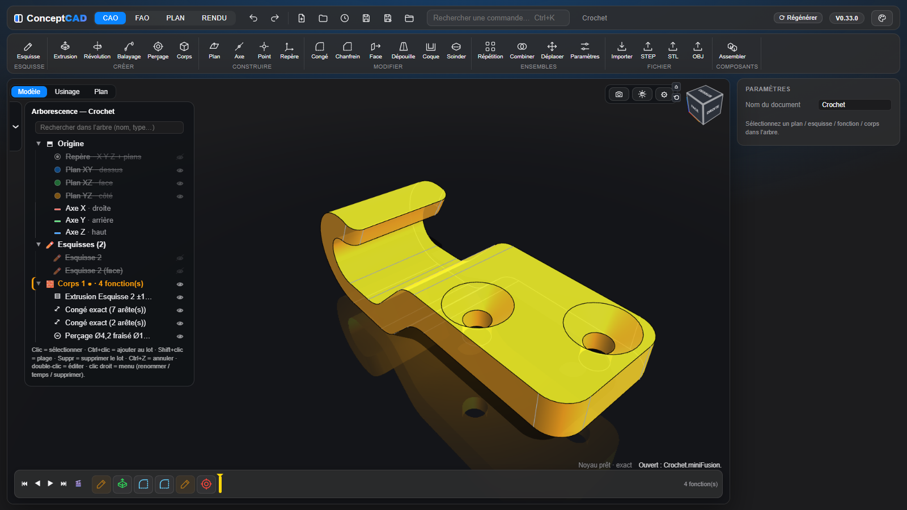

[ConceptCAD](../../README.md) › [Manuel](README.md) › Esquisse

# Esquisse

- **Tracé guidé** :
  - accroche aux points, milieux et centres ;
  - inférences H / V, ⟂, tangente, **parallèle** et **prolongement** d'une ligne (guide tracé, contrainte posée au clic) ;
  - un point glissé s'accroche aux points, milieux, lignes et cercles, et la **contrainte est posée au lâcher** ;
  - longueur et angle tapés pendant le tracé.
- **Outils**, avec **plusieurs façons de tracer choisies dans un bandeau** :
  - **ligne** ;
  - **rectangle** : 2 coins, centre et coin, 3 points en biais ;
  - **cercle** : centre et rayon, 2 points, 3 points, tangent à 2 ou 3 traits ;
  - **arc** : centre et 2 points, 3 points, tangent à 1 ou 2 traits (touche `A`) ;
  - **oblong en 3 clics** : 2 centres, 2 extrémités ou centre et écartement, puis le rayon ; cotes posées au 3e clic (touche `B`) ;
  - **oblong en arc** (rainure circulaire à bouts arrondis : 3 points ou centre) et **secteur** (portion d'anneau à bouts droits), cotés à la création ;
  - **polygone régulier** : nombre de côtés et Ø intérieur tangent aux côtés (touche `G`) ;
  - **texte**, avec **toutes les polices de l'ordinateur** (ou un fichier `.ttf`, `.otf`, `.ttc` choisi, gardé pour les fois suivantes) : style, hauteur des majuscules, angle, espacement, interligne, alignement, **miroir** (moules, tampons) ; les lettres sont de vraies courbes, prêtes à **extruder en relief ou en creux** comme tout profil, les contre-formes (intérieur du O, du A…) se choisissent à part ; **double-clic** sur le texte pour le modifier ; son point de départ se glisse, se cote et se contraint, le texte suit ; le fichier garde les lettres, il se rouvre même sans la police ;
  - **spline** ;
  - **points** de construction et de perçage (perçage = rond orange, point ordinaire = carré) ;
  - **projection associative** d'arêtes, **intersection** du plan avec des faces ou un corps ;
  - congé, chanfrein, ajustement ;
  - **décalage 2D comme Fusion** : un clic prend le trait ou toute sa chaîne tangente, aperçu à 3 mm du côté proposé, inverser, des deux côtés ; la copie n'est jamais en construction.
- **Repères visuels** : le bouton de l'outil ou de la fonction en cours reste allumé tant qu'elle est active, dans l'esquisse comme dans le ruban. Une contrainte ou une cote cliquée dans le panneau surligne en jaune ce qu'elle vise.
- **Projection d'arêtes** : aussi celles des autres composants. Une projetée reste fixe et ne bouge qu'avec son arête source ; un point rendu coïncident avec elle vient s'y coller ; ajustée, elle reste entière en construction et le tronçon gardé devient une droite posée dessus.
- **Arêtes du solide sans projeter** : elles s'allument au survol (bouts en carrés) et servent directement au tracé et à la cote, projetées d'office et associatives.
  - Sont concernés : les arêtes du solide situées dans le plan de l'esquisse (trait plein), celles hors du plan vues en projection (tiretés), leurs sommets, milieux, centres et croisements, et les points où une arête traverse le plan.
  - Sans outil actif, un clic les sélectionne comme une entité d'esquisse (`Ctrl` pour ajouter).
- **Projeter d'une esquisse à une autre** : avec **⧉ Projeter**, les autres esquisses visibles s'affichent en bleu ; un clic reprend un point, une ligne, un cercle, un arc ou une courbe, qui suit ensuite sa source (sur un plan incliné, un cercle devient une ellipse).
- **Traits d'esquisse épais en 3D** : les esquisses visibles se lisent aussi à travers les solides, en plus fin pour la partie cachée.
- **Splines** par points de passage ou par points de contrôle, ouvertes ou fermées : poignées de tangence cotables, **tangence** et **courbure continue (G2)** avec une ligne, un arc ou une autre spline, **peigne de courbure** ; ajustement, jonction en T, décalage, intersection et projection en splines.
- **13 contraintes** (horizontal, vertical, parallèle, perpendiculaire, colinéaire, égal, symétrie, tangence, coaxial, milieu, fixe, coïncident, construction) et **cotes pilotées** (longueur, Ø, rayon, distance, angle, entraxe).
- **Cotation souple** :
  - la valeur se tape pendant la pose (Entrée pose) ;
  - le texte se glisse avec sa ligne de cote ;
  - **double-clic sur le chiffre, la ligne de cote, ses flèches ou ses lignes de rappel** (ou la ligne d'attache d'un rayon) pour la modifier de suite ;
  - clic de l'outil Cote sur une cote existante pour la modifier ;
  - cote de **référence** à la demande (clic droit) ;
  - nom d'une autre cote inséré d'un clic pendant la saisie (`d1`, `d2`…) ;
  - unités dans les expressions (`2 cm + 3`, `1 in`) ;
  - la barre d'état nomme ce qui détermine déjà une cote redondante.
- **Solveur** qui bouge l'esquisse le moins possible :
  - une cote impossible est refusée, et la barre d'état dit pourquoi ;
  - une cote d'angle reste tenue quand une ligne change de sens en repassant par son sommet ;
  - degrés de liberté réels : esquisse bleue (sous-contrainte) ou blanche (totalement contrainte).
- **Vue d'esquisse** à plat ou dans la vue 3D courante, pièce en transparence, orbite au clic-molette comme en 3D, touche `N` pour revenir à plat ; la roue ⚙ porte les réglages de l'esquisse (Grille 1 mm, À plat, Effacer tout).
- **Paramètres nommés**, **expressions ƒx** (aussi dans les commandes, avec `pi`) et **configurations** (tables de variantes).
  - Dès la 1re lettre, une **liste propose les paramètres** (Entrée insère le nom sans valider le champ).
  - **Conditions** `if(L > 100 ; 5 ; 3)` et **arrondis au pas** `roundmoins(x ; 0,5)`, `roundplus(x ; 5)`.
  - **Clic sur ƒx** : mini-liste des paramètres dans le bandeau de droite, où chaque valeur se **modifie sur place** (nombre ou formule ; Entrée valide, Échap annule). **Clic droit** : liste complète.
  - Une valeur tapée reste acquise, quelle que soit la façon de quitter le champ : Tab va au champ suivant, et le clic qui suit (Valider, une case, l'arbre) agit du premier coup.
  - **La formule reste dans le champ** (`pas_SM_chaud*2`, `nb+1`) et la valeur **suit les paramètres**, en CAO comme en FAO et dans le plan. Taper un nombre retire la formule. La fiche d'un repère validé montre chaque valeur avec sa formule.
- **Paramètre mesuré entre 2 faces** : il **vaut la mesure et suit la pièce** (écart de plans parallèles, entraxe, axe ↔ face, sinon distance mini).
  - Pour le créer : bouton **« + Mesure »** de la fenêtre ƒx Paramètres, puis un clic sur chaque face.
  - Ou, après une mesure `Ctrl+clic` sur 2 faces : bouton **« Créer un paramètre »**, ou petit **ƒx** collé à la cote verte de la vue 3D, qui le crée d'un clic.
  - Il ne se règle pas à la main, mais sert dans les autres valeurs (`Ecart1/2`), qui suivent.
  - 👁 montre les 2 faces et la cote ; ⚠ si une face disparaît.

---

[← Téléphone et tablette](telephone.md) · [Sommaire du manuel](README.md) · [Fonctions 3D →](fonctions-3d.md)
