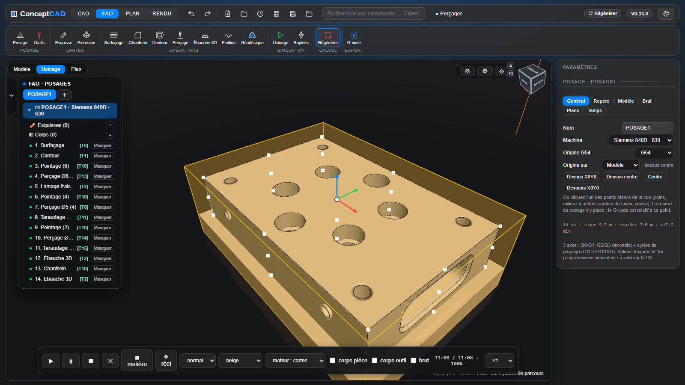

[ConceptCAD](../../README.md) › [Manuel](README.md) › FAO

# FAO

## Posage

- Le repère du posage est **le repère d'usinage** : origine sur un des **27 points cardinaux** du brut ou du modèle, directions Z / X sur un axe, une face ou une arête, cases « Inverser ». La vue tourne autour du Z du posage.
- **Brut** : boîte, cylindre ou corps réel du modèle ; marges et surépaisseurs.
- **Machine** : Siemens 840D (630 / 1520) ou Fagor 8065, origine G54–G59.
- **Dégagement** : approche de chaque opération, changement d'outil, rotation du plateau. Après un changement d'outil, l'outil précédent remonte sur place, puis le nouvel outil va directement au-dessus de son entrée.
- **Retrait** : rapides entre les passes, au plan de retrait ou en **retrait minimum** réglable, sans jamais traverser la matière restante.
- **Paramètres et formules** dans les champs du posage, des opérations, des outils et des porte-outils (`ep/2`, `pas_SM_chaud-0,5`) : la formule reste affichée, la valeur suit les paramètres et seules les opérations touchées sont à régénérer. Les coins X/Y des zones et les Z de perçage affichés dans le repère de l'opération gardent un résultat figé.
- **Menu du posage** (clic droit sur le posage dans l'arbre ou sur son onglet) : **G-code de ce posage**, **Geler / Dégeler le posage**, **Copier**, **Dupliquer**. Un posage gelé est barré avec toutes ses opérations : plus d'aperçu, de simulation ni de G-code ; au dégel, chaque opération retrouve son état d'avant (active ou non).
- **Outils** : fraises cylindriques, boules, toriques, à chanfreiner, forets, forets à pointer et à centrer (DIN 333 A), tarauds.
  - **Fiche en onglets** : Identification, Géométrie, Coupe, Porte-outil.
  - **Exporter / importer** (fenêtre Outils) : **⬇ Exporter l’outil** enregistre la fiche sélectionnée, **⬇ Tout exporter** toute la bibliothèque du posage, dans un fichier `.ccoutils`. **⬆ Importer…** ajoute les outils d'un fichier : s'il en contient plusieurs, une fenêtre les liste avec une case chacun (**Tout cocher** / **Tout décocher**) ; ceux déjà présents à l'identique sont décochés d'office. Un outil importé garde son numéro T s'il est libre.
  - **Catalogues des fabricants** : le bouton **📖 Catalogue…** ouvre une page où l'on choisit le fabricant, la série (fraises, forets, tarauds) et la **matière usinée** ; chaque référence affiche sa géométrie et ses conditions de coupe (Vc, avance, S et F), et **Insérer** crée les outils cochés dans la bibliothèque. Un catalogue est un fichier `.cccatalogue` par fabricant, chargé par **Charger un catalogue…** et gardé dans le navigateur (les données des fabricants ne sont pas livrées avec ConceptCAD). Quand le fabricant donne une fourchette, la liste **Dans la fourchette du fabricant** choisit le bas, le milieu ou le haut ; une référence dont le diamètre sort du tableau du fabricant est signalée et son avance reste à saisir. [Fichier de démonstration](catalogue-exemple.cccatalogue), aux valeurs fictives.
  - **Queue plus grosse que l'outil** : le champ **Cône vers la queue** donne la longueur du cône de raccord (0 : épaulement droit).
  - **Porte-outils** : chaque fiche choisit son porte-outil (**Générique** ou un porte-outil du posage). **+ Nouveau**, **Dupliquer**, **Supprimer** ; un porte-outil se décrit du nez vers la broche par des tronçons **Chanfrein d'entrée**, **Cône** et **Cylindre**, dessinés à l'échelle sur le schéma de l'outil. Il suit son outil dans les fichiers `.ccoutils`.
  - **Catalogue standard** : sous le choix du porte-outil, la liste **+ Du catalogue standard…** propose porte-pinces ER (ER16 à ER40), frettage et Weldon, pour une broche SK40, BT40 ou HSK-A63 ; les références qui acceptent la queue de l'outil sont en tête. Cotes indicatives des séries courantes : le porte-outil inséré se corrige d'après le catalogue du fabricant.

## Opérations

- **Surfaçage**, **Poche**, **Contour** (côté auto, passes radiales, attaches ; descente en **paliers** ou en **pente** réglable).
  - **Surfaçage, passe de finition** (case à cocher de la fiche) : l'ébauche laisse une **épaisseur** au-dessus de la cote, enlevée ensuite en une ou plusieurs **passes de finition** égales, la dernière à la cote Z ; **Toujours dans le même sens** usine chaque ligne de finition dans la même direction (retour en rapide au-dessus de la pièce) au lieu du va-et-vient.
  - **Surfaçage, sens d’usinage** : lignes le long de **X**, de **Y**, ou dans la direction d’une **arête** droite ou d’une **face** cliquée (face plane : sa normale ; cylindre : son axe) ; **Inverser** retourne le sens.
- **Chanfrein** sur arêtes cliquées, **en plan** (Z fixe) ou **en 3D** : la pointe suit le Z de l'arête, l'axe de l'outil reste vertical (3 axes).
- **Perçage** : les trous sont **reconnus sur le modèle** (Ø, profondeur, débouchant ou borgne, lamage, filet) et choisis par groupe.
  - Cycles : pointage, perçage, débourrage, taraudage, **lamage fraisé en hélice**.
  - **Gamme automatique** pointage → perçage → lamage → taraudage, avec les forets pris dans la bibliothèque ou créés.
- **Ébauche 3D** : niveaux en Z, minipasses, une région finie avant l'autre ; deux stratégies :
  - **Trochoïdal** : spirale avec arcs de dégagement ;
  - **Escargot** : anneaux concentriques autour des îlots, départ par l'extérieur, suivi du brut restant (carte du brut).

  Les entrées ne plongent **jamais en pleine matière** : par l'extérieur en arc, en hélice ou en rampe douce (pente ≤ 0,4). Les descentes dans l'air se font en **rapide**, jusqu'au brut restant.

  **Mini-passes sur** : *toutes les parois* (par défaut) ou *pentes seulement* — les mini-passes ne reprennent alors que les morceaux de paroi où le niveau du dessous a laissé une marche (chanfreins, dépouilles, pentes) et sautent les parois verticales ; fraise droite, torique ou boule. En *pentes seulement*, la **Marche maxi** (mm, 0 = off) fait du nombre de mini-passes un maximum : aucune où la paroi est presque verticale, davantage où la pente est douce, pour ne jamais laisser plus que cette épaisseur en escalier.
- **Finition** (passes parallèles ou à crête constante) et **Géodésique** (passes à distance constante depuis les bords des faces).
- **Zones** : rectangle, chaîne d'arêtes, esquisse, îlots. La zone choisie est **projetée en orange** tant que l'opération est sélectionnée : sur le plan de fond pour les opérations 2D, sur le plan de la sélection quand elle est plane pour l'ébauche 3D, la finition et la géodésique, sur le plan des deux premières arêtes pour le chanfrein.
- **Onglet Hauteurs** unique dans chaque fiche : Dégagement, Retrait, puis Haut et Bas, en valeur saisie ou sur une **référence** (brut, modèle, bridage, **face cliquée**) plus un décalage ; alertes si les hauteurs se croisent.
- **Faces usinables / intouchables** par opération.
- **Limites propres à la FAO** (ruban FAO → Limites) : esquisses et extrusions, en **solide** ou en **surface**, qui servent de murs ou de surfaces infranchissables sans toucher au modèle.
- **Calcul sur plusieurs cœurs** : « Tout régénérer » répartit les opérations longues sur les cœurs du processeur ; l'écran reste fluide et les parcours sont strictement les mêmes.
- **Après une modification de la pièce** : le maillage que la FAO lit sur le solide n'est refait que pour les faces modifiées (mêmes triangles qu'un maillage complet, les parcours gardés restent valables).
- **Répétition** (comme le Motif de Fusion 360) : choisir les opérations par `Ctrl+clic`, puis **Répétition**. **Rectangulaire** (nombre et pas en X et Y), **Circulaire** (nombre, angle total, centre), **Symétrie** (plan X = … ou Y = … ; le sens de coupe s'inverse) ou **Autres origines** (mêmes parcours refaits en G55, G56…). Usinage **par opération** : chaque opération sur toutes les copies avant la suivante. Les opérations répétées portent « ↻ » et le numéro de leur répétition ; une répétition désactivée les laisse usinées une seule fois.
- **Copier / coller** (`Ctrl+C` / `Ctrl+V`) une ou plusieurs opérations, ou un posage complet.
- **Supprimer plusieurs opérations** : `Ctrl+clic` / `Maj+clic` pour les choisir, `Suppr` pour les retirer ensemble ; un seul `Ctrl+Z` les rétablit.
- **Dans la vue** : un clic sur une face l'allume et la mesure sans éditer de fonction ; un clic dans la vue désélectionne le posage ou l'opération.

## Simulation, 3+2 et G-code

- **Parcours à l'écran** : rapides et remontées bien visibles, et distincts des passes d'usinage.
- **Collisions du porte-outil** : dans la simulation, le bouton **⚠ Collisions** rejoue tout le posage et signale chaque opération où le porte-outil (ou une queue plus grosse que l'outil) entre dans la matière restante, rapides compris ; un repère rouge marque le contact, un second clic y amène la simulation. L'outil simulé a sa vraie longueur et son vrai porte-outil. Opérations inclinées (3+2) : contrôle indicatif.
- **Simulation** sur la **carte graphique** : outil réel, matière enlevée à partir du vrai brut.
  - Rendu réel ou lisse ; sol miroir et plan d'ombre placés sous le brut.
  - Deux moteurs : **cartes de hauteurs** (une par orientation en 3+2, lancer de rayons) ou **champ de distance**.
  - La vue tourne autour du point visé sur les faces de la pièce, même sous la matière pas encore enlevée (hors de la pièce : sur la matière), et zoome vers lui.
- **3+2** : chaque opération peut avoir son propre Z et X.
  - Sur Siemens, le plan de travail pivote par **`CYCLE800`** ; les arcs G2/G3 et les cycles de perçage sont écrits dans le plan incliné.
  - Dégagement avant pivotement en coordonnées machine (`SUPA Z600`, `SUPA X`) ; sens de pivotement réglable par machine (`swivelDir`, plateau tourné vers les outils).
  - Comme le post Fusion des Spinner : table remise à plat par `CYCLE800` en début de programme, plan redonné après chaque changement d'outil, brut décrit à la CN par `WORKPIECE` (« box » de la simulation Siemens).
- **Exporter G-code** : un programme par posage non gelé ; le menu du posage exporte le sien seul.
- **G-code** multi-outils, cycles du dialecte (CYCLE81 à 84 ; Fagor G81 avec temporisation K, G83 compté depuis le plan d’approche, G84), avance F modale. *Validez toujours un premier programme à vide sur la machine.*
- **Cache des parcours** : rien n'est recalculé tant que la géométrie ne change pas.

---

[← Assemblage](assemblage.md) · [Sommaire du manuel](README.md) · [PLAN →](plan.md)
