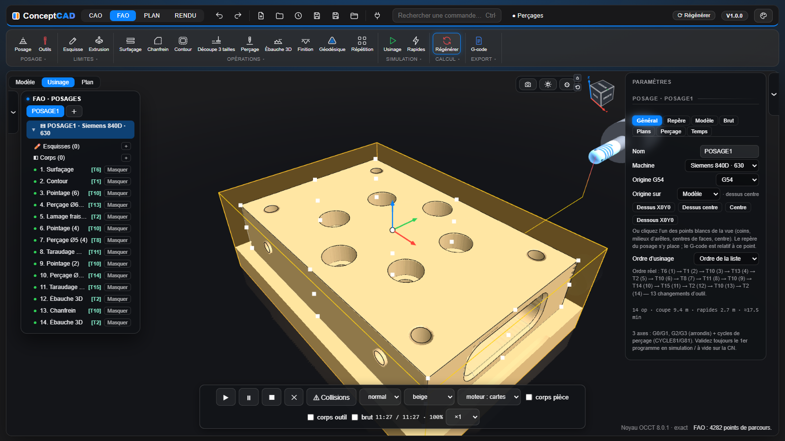

[ConceptCAD](../../README.md) › [Manuel](README.md) › FAO

# FAO

## Posage

- Le repère du posage est **le repère d'usinage** : origine sur un des **27 points cardinaux** du brut ou du modèle, directions Z / X sur un axe, une face ou une arête, cases « Inverser ». La vue tourne autour du Z du posage ; le sol, son reflet et l'éclairage le suivent.
- **Brut** : boîte, cylindre ou corps réel du modèle ; marges et surépaisseurs.
- **Machine** : Siemens 840D (630 / 1520) ou Fagor 8065, origine G54–G59.
- **Dégagement** : approche de chaque opération, changement d'outil, rotation du plateau. Après un changement d'outil, l'outil précédent remonte sur place, puis le nouvel outil va directement au-dessus de son entrée.
- **Retrait** : rapides entre les passes, au plan de retrait ou en **retrait minimum** réglable : l'outil ne monte que de cette valeur au-dessus de sa passe et ne passe plus haut que pour franchir la pièce ou le brut restant qu'il balaierait vraiment, sans jamais traverser la matière.
- **Paramètres et formules** dans les champs du posage, des opérations, des outils et des porte-outils (`ep/2`, `pas_SM_chaud-0,5`) : la formule reste affichée, la valeur suit les paramètres et seules les opérations touchées sont à régénérer. Les coins X/Y des zones et les Z de perçage affichés dans le repère de l'opération gardent un résultat figé.
- **Menu du posage** (clic droit sur le posage dans l'arbre ou sur son onglet) : **G-code de ce posage**, **Geler / Dégeler le posage**, **Copier**, **Dupliquer**. Un posage gelé est barré avec toutes ses opérations : plus d'aperçu, de simulation ni de G-code ; au dégel, chaque opération retrouve son état d'avant (active ou non). **Régénérer** recalcule tous les posages non gelés (opérations activées) ; les posages gelés et les opérations désactivées gardent leurs parcours.
- **Outils** : fraises cylindriques, boules, toriques, à chanfreiner, forets, forets à pointer et à centrer (DIN 333 A), tarauds.
  - **Fiche en onglets** : Identification, Géométrie, Coupe, Porte-outil.
  - **Exporter / importer** (fenêtre Outils) : **⬇ Exporter l’outil** enregistre la fiche sélectionnée, **⬇ Tout exporter** toute la bibliothèque du posage, dans un fichier `.ccoutils`. **⬆ Importer…** ajoute les outils d'un fichier : s'il en contient plusieurs, une fenêtre les liste avec une case chacun (**Tout cocher** / **Tout décocher**) ; ceux déjà présents à l'identique sont décochés d'office. Un outil importé garde son numéro T s'il est libre.
  - **Catalogues des fabricants** : le bouton **📖 Catalogue…** ouvre une page où l'on choisit le fabricant, la série (fraises, forets, tarauds) et la **matière usinée** ; chaque référence affiche sa géométrie et ses conditions de coupe (Vc, avance, S et F), et **Insérer** crée les outils cochés dans la bibliothèque. Un catalogue est un fichier `.cccatalogue` par fabricant, chargé par **Charger un catalogue…** et gardé dans le navigateur (les données des fabricants ne sont pas livrées avec ConceptCAD). Quand le fabricant donne une fourchette, la liste **Dans la fourchette du fabricant** choisit le bas, le milieu ou le haut ; une référence dont le diamètre sort du tableau du fabricant est signalée et son avance reste à saisir. [Fichier de démonstration](catalogue-exemple.cccatalogue), aux valeurs fictives.
  - **Queue plus grosse que l'outil** : le champ **Cône vers la queue** donne la longueur du cône de raccord (0 : épaulement droit).
  - **Porte-outils** : chaque fiche choisit son porte-outil (**Générique** ou un porte-outil du posage). **+ Nouveau**, **Dupliquer**, **Supprimer** ; un porte-outil se décrit du nez vers la broche par des tronçons **Chanfrein d'entrée**, **Cône** et **Cylindre**, dessinés à l'échelle sur le schéma de l'outil. Il suit son outil dans les fichiers `.ccoutils`.
  - **Catalogue standard** : sous le choix du porte-outil, la liste **+ Du catalogue standard…** propose porte-pinces ER (ER16 à ER40), frettage et Weldon, pour une broche SK40, BT40 ou HSK-A63 ; les références qui acceptent la queue de l'outil sont en tête. Cotes indicatives des séries courantes : le porte-outil inséré se corrige d'après le catalogue du fabricant.

## Opérations

- **Surfaçage**, **Poche**, **Contour** (côté auto, passes radiales, attaches ; descente en **paliers** ou en **pente** réglable).
  - Contour, **Rapide dans le vide** (coché par défaut) : là où la fraise ne toucherait aucune matière (au-dessus ou à côté du brut, ou matière déjà enlevée par les opérations placées avant dans le posage), elle remonte et va en rapide jusqu'au prochain point d'entrée en matière, puis redescend en avance 1 mm avant. Une passe entièrement dans le vide est retirée. La passe la plus proche de la paroi n'est jamais sautée. Modifier une opération placée avant met le contour « à régénérer ».
  - **Surfaçage, passe de finition** (case à cocher de la fiche) : l'ébauche laisse une **épaisseur** au-dessus de la cote, enlevée ensuite en une ou plusieurs **passes de finition** égales, la dernière à la cote Z ; **Toujours dans le même sens** usine chaque ligne de finition dans la même direction (retour en rapide au-dessus de la pièce) au lieu du va-et-vient.
  - **Surfaçage, sens d’usinage** : lignes le long de **X**, de **Y**, ou dans la direction d’une **arête** droite ou d’une **face** cliquée (face plane : sa normale ; cylindre : son axe) ; **Inverser** retourne le sens.
- **Chanfrein** sur arêtes cliquées, **en plan** (Z fixe) ou **en 3D** : la pointe suit le Z de l'arête, l'axe de l'outil reste vertical (3 axes).
- **Perçage** : les trous sont **reconnus sur le modèle** (Ø, profondeur, débouchant ou borgne, lamage, filet) et choisis par groupe.
  - Cycles : pointage, perçage, débourrage, taraudage, **alésage** (alésoir : entrée et sortie en avance, CYCLE85 / G85), **lamage ou alésage fraisé en hélice**.
  - **Gamme automatique** pointage → perçage → fraisure → lamage → alésage → taraudage, avec les outils pris dans la bibliothèque ou créés. Elle se lance seule quand on crée un Perçage avec des trous sélectionnés.
  - **Fenêtre « Gamme de perçage »** : à la création (trous sélectionnés puis *Perçage*, ou bouton *⚙ Gamme*), elle demande l'outil de pointage (ou **sans pointage**), la finition des alésages et l'outil des fraisures quand la sélection en contient, et la nature des trous d'une pièce importée ; les choix restent ceux du posage pour la gamme suivante.
  - **Réglages de la gamme** (aussi dans la fiche du posage, onglet *Perçage*, ou la fiche d'un Perçage) : l'outil de **pointage** (automatique, foret à pointer, foret à centrer, un outil précis de la bibliothèque, ou **sans pointage**) et la **finition des alésages** (alésoir ou fraise).
  - **Trou alésé** (les 4 cas de la fonction Perçage) : pré-trou au Ø d'alésage moins l'écart choisi dans la fonction (sinon 0,1 à 0,5 mm selon le Ø), puis alésoir ou fraise. Quand la fonction a son propre perçage au bon Ø, il sert de pré-trou. Un alésage à fond plat est pré-percé pointe au fond, sans descendre plus bas.
  - **Fraisure** : faite après le perçage, au **foret à pointer** ou à la **fraise à chanfreiner** (réglage de la gamme), du même angle et assez gros pour toute la fraisure ; le méplat de bout de la fraise est compté dans la profondeur ; le pointage ne la creuse plus.
  - **Reconnaissance rapide** : le côté de la matière est lu sur la paroi de chaque trou (trou ou pion), sans sonder la pièce autour ; les trous suivent la pièce après chaque modification sans la ralentir (SIRAP-14-002 : ajout d'un perçage 1,85 → 0,94 s). Les trous de **tous les corps** d'une pièce ou d'un assemblage importé sont vus.
  - **Double perçage** : seul le gros trou est fait ; le petit trou, s'il débouche, est laissé pour l'autre côté.
  - **Pièce importée (STEP)** : la même fenêtre demande la nature de chaque groupe de trous (lisse, taraudé, alésé H6/H7/H8, lamage, fraisure).
  - **Trous de plusieurs axes (3+2)** : trous cliqués sur plusieurs faces, ou **perçage normal** d'un congé (la fonction choisie dans l'arbre, ou un de ses trous cliqué, entraîne tous ses trous) : une opération par orientation du plateau, avec son repère (Z = axe du trou, **X du côté où penche l'outil**, vers la poche : le plateau pivote toujours du même côté). Une seule fenêtre pour toutes ; les opérations sont rangées étape par étape (tous les pointages, puis les perçages…), chaque outil d'un seul tenant, les orientations voisines à la suite. SIRAP-14-002 : 36 Ø1,5 dans les congés → 16 orientations, 2 outils, 2 changements d'outil.
- **Ébauche 3D** : niveaux en Z (de *ap* en *ap*, avec un arrêt sur chaque fond de la pièce **à portée de l'outil dans la zone** : un épaulement hors de la limite n'ajoute pas de passe), minipasses, une région finie avant l'autre ; deux stratégies :
  - **Trochoïdal** : spirale avec arcs de dégagement ;
  - Dans la liste **Mode**, survoler un choix ouvre une étiquette : son explication et un petit dessin animé du parcours vu de dessus (coupe, déplacements à vide, descentes).
  - **Escargot** : anneaux concentriques autour des îlots, départ par l'extérieur, suivi du brut restant (carte du brut).
    - **Une seule entrée (hélice unique)** : une hélice par niveau au centre (aucune si la zone donne sur le vide : entrée à plat par l'extérieur), puis la fraise vide toute la surface en escargot depuis ce point — spirale continue tant qu'aucun mur ne la coupe, puis arcs qui contournent murs et îlots. Les passages d'un morceau à l'autre glissent à la cote dans la zone déjà vidée ; la fraise ne se relève que si aucun passage dégagé n'existe.
  - **Contours** : une seule hélice au centre (aucune si la zone donne sur le vide), une courte spirale pour ouvrir le cœur de la zone, puis des passes **parallèles aux îlots et aux parois** qui suivent leur forme. Chaque passe ne prend que la matière qui reste vraiment (les parties déjà vidées sont sautées) ; une portion trop chargée attend que ses voisines soient faites, et s'il reste de la matière que le tour des parois ne prendra pas, une passe la reprend. Le travail se fait **zone par zone** : la fraise finit une zone (l'intérieur, puis ses parois, puis un contrôle qu'il ne reste plus de matière) avant de passer à la plus proche. Les petits trajets restent à la cote dans la partie déjà vidée ; un long trajet se fait en remontée et rapide, avec une descente dans une partie déjà vidée (jamais une deuxième hélice). Dans un couloir étroit, la première passe peut prendre toute la largeur de la fraise. Pour attaquer une nouvelle zone, la fraise descend dans une partie déjà vidée puis avance vers la matière. Une bande ou une rainure de largeur constante est une zone à elle seule, suivie d'un bout à l'autre. Le tour des parois suit le bord exact de la pièce : lignes droites, arcs propres et vrais coins, sans zigzag dans les rayons ; une limite de la zone d'usinage a aussi son tour. Quand le tour d'une paroi est fait en deux fois, la seconde passe croise la première d'un demi-diamètre le long de la paroi : pas de petit triangle de matière à la jonction. Dans une gorge à peine plus large que la fraise, les passes sont deux courbes parallèles aux parois (une contre chaque bord), sans vagues.

  **Brut** : *Brut du posage* (par défaut) ou *Brut restant (opérations précédentes)* — usinage de reprise : les opérations actives placées avant l’ébauche dans le posage, **3+2 compris**, sont rejouées et l’ébauche ne passe que là où il reste de la matière (coins et recoins qu’une fraise plus grosse n’a pas atteints, marches laissées par un pas plus grand, matière au-dessus d’un surfaçage incliné). *Ignorer moins de* (0,25 mm) : la surépaisseur laissée par l’opération précédente le long des parois et des fonds ne déclenche pas de passe. Modifier une opération précédente met la reprise à régénérer.

  Les entrées ne plongent **jamais en pleine matière** : par l'extérieur en arc, en hélice ou en rampe douce (pente ≤ 0,4). Chaque fiche (Poche, Contour, Ébauche 3D, Finition) règle son entrée : **Entrée** (cercle, auto, hélice, rampe), **Rayon d’entrée**, **Hélice : descente / tour**, **Hélice : rayon maxi** (l’hélice reste toujours dans la place libre) et, en Ébauche 3D, **Rampe : pente maxi** (degrés) ; 0 = automatique. Les descentes dans l'air se font en **rapide**, jusqu'au brut restant.

  **Escargot** : après la spirale, les coins sont finis un par un ; chaque arc commence par un demi-cercle depuis le déjà-vidé et finit par un quart de cercle, la passe des parois vient en dernier.

  **Fraise torique ou boule** : la passe le long des parois suit le contact réel de l'outil ; la laisse *Parois* s'applique sur les côtés seulement, la laisse du fond reste celle des cotes.

  **Mini-passes sur** : *toutes les parois* (par défaut) ou *pentes seulement* — les mini-passes ne reprennent alors que les morceaux de paroi où le niveau du dessous a laissé une marche (chanfreins, dépouilles, pentes) et sautent les parois verticales ; fraise droite, torique ou boule. En *pentes seulement*, la **Marche maxi** (mm, 0 = off) fait du nombre de mini-passes un maximum : aucune où la paroi est presque verticale, davantage où la pente est douce, pour ne jamais laisser plus que cette épaisseur en escalier.
- **Finition** (passes parallèles ou à crête constante) et **Géodésique** (passes à distance constante depuis les bords des faces).

  **Lissage** (crêtes constantes, onglet *Passes*, de 0 à 10, 0 par défaut) : adoucit les passes là où la distance au bord fait des cassures (coins, congés, fonds bosselés) — les anneaux suivent une forme plus ronde, sans se chevaucher ni sortir de la zone ; plus le facteur est grand, plus l’effet porte loin des bords. Dans tous les cas, les passes sont maintenant lissées en 3D sur la surface (plus de tracés « tortueux » sur les congés), et quand deux bords se rejoignent dans une bande étroite (moins d’un demi-rayon d’outil en moyenne, comme entre deux renforts en regard), les passes s’arrêtent sur la **ligne de rencontre** en V net, avec une passe unique le long de cette ligne, au lieu de petites boucles fermées.

  **Ignorer les trous** (crêtes constantes, onglet *Passes*) : **cochée par défaut** — les trous de la zone jusqu’au Ø indiqué (10 mm par défaut) sont traités comme bouchés — la boule passe par-dessus au niveau du fond, sans tourner autour ni y plonger. Moins de remontées et de rapides quand le fond est percé de nombreux trous.

  **Régénération plus rapide** : la préparation de la pièce pour l’outil est gardée d’un calcul à l’autre (même pièce, même outil, même laisse) — une finition en brut restant refaite après un changement de pas démarre tout de suite (SIRAP-14-002 : 13,5 → 9,7 s). Mémoire rendue après 10 minutes sans FAO.

  **Brut** de la finition (et de la géodésique) : case *Brut restant (opérations précédentes)* — vide (par défaut), la boule passe sur toute la zone ; cochée, finition de reprise : la boule ne passe que là où elle enlève encore de la matière laissée par les opérations précédentes, 3+2 compris (congés et recoins qu’une boule plus grosse n’a pas atteints, crêtes trop hautes). Plus besoin de tracer une limite intérieure pour éviter de repasser sur ce qui est déjà fini. *Ignorer moins de* (0,1 mm) : les crêtes plus basses ne déclenchent pas de passe (jamais moins du quart de la maille de la carte ; la fiche indique la valeur appliquée). *Marge* (1 mm) : tout point de passe à moins de cette distance d’un endroit où la boule enlève de la matière est usiné aussi, le long de la passe et sur les passes voisines, pour que la boule soit bien passée partout sur le bord de la zone restante. En crêtes constantes, la zone où il reste de la matière (avec la marge) devient la **limite intérieure** du calcul, lissée (zones voisines de moins d’un rayon d’outil réunies, bord adouci) : les passes en font le tour en boucles continues, sans remontée à chaque traversée — SIRAP-14-002, boule Ø6 : 21 m de rapides et 181 remontées → 1,6 m et 25. En passes parallèles et en géodésique, entre deux morceaux, l’outil remonte et se repose en avance au début du suivant ; les morceaux sont enchaînés au plus proche, sans traverser la pièce.
- **Zones** : rectangle, chaîne d'arêtes, esquisse, îlots. La zone choisie est **projetée en orange** tant que l'opération est sélectionnée : sur le plan de fond pour les opérations 2D, sur le plan de la sélection quand elle est plane pour l'ébauche 3D, la finition et la géodésique, sur le plan des deux premières arêtes pour le chanfrein.
- **Onglet Hauteurs** unique dans chaque fiche : Dégagement, Retrait, puis Haut et Bas, en valeur saisie ou sur une **référence** (brut, modèle, bridage, **face cliquée**) plus un décalage ; alertes si les hauteurs se croisent.
- **Faces usinables / intouchables** par opération.
- **Limites propres à la FAO** (ruban FAO → Limites) : esquisses et extrusions, en **solide** ou en **surface**, qui servent de murs ou de surfaces infranchissables sans toucher au modèle.
- **Triangle ⚠ d'une opération** : il ne régénère qu'elle, et son parcours se dessine au fur et à mesure du calcul, comme avec « Tout régénérer ».
- **Calcul sur plusieurs cœurs** : « Tout régénérer » répartit les opérations longues sur les cœurs du processeur ; l'écran reste fluide et les parcours sont strictement les mêmes.
- **Après une modification de la pièce** : le maillage que la FAO lit sur le solide n'est refait que pour les faces modifiées (mêmes triangles qu'un maillage complet, les parcours gardés restent valables).
- **Répétition** (comme le Motif de Fusion 360) : choisir les opérations par `Ctrl+clic`, puis **Répétition**. **Rectangulaire** (nombre et pas en X et Y), **Circulaire** (nombre, angle total, centre), **Symétrie** (plan X = … ou Y = … ; le sens de coupe s'inverse) ou **Autres origines** (mêmes parcours refaits en G55, G56…). Usinage **par opération** : chaque opération sur toutes les copies avant la suivante. Les opérations répétées portent « ↻ » et le numéro de leur répétition ; une répétition désactivée les laisse usinées une seule fois.
- **Copier / coller** (`Ctrl+C` / `Ctrl+V`) une ou plusieurs opérations, ou un posage complet.
- **Supprimer plusieurs opérations** : `Ctrl+clic` / `Maj+clic` pour les choisir, `Suppr` pour les retirer ensemble ; un seul `Ctrl+Z` les rétablit.
- **Dans la vue** : un clic sur une face l'allume et la mesure sans éditer de fonction ; un clic dans la vue désélectionne le posage ou l'opération.

## Simulation, 3+2 et G-code

- **Parcours à l'écran** : rapides et remontées bien visibles, et distincts des passes d'usinage.
- **Afficher / masquer un parcours** : instantané, même sur une grosse pièce ; Ctrl+Z le rétablit sans recalculer.
- **Collisions du porte-outil** : dans la simulation, le bouton **⚠ Collisions** rejoue tout le posage et signale chaque opération où le porte-outil (ou une queue plus grosse que l'outil) entre dans la matière restante, rapides compris ; un repère rouge marque le contact, un second clic y amène la simulation. L'outil simulé a sa vraie longueur et son vrai porte-outil. Opérations inclinées (3+2) : contrôle indicatif.
- **Simulation** sur la **carte graphique** : outil réel, matière enlevée à partir du vrai brut.
  - Rendu réel, matière toujours visible ; sol miroir et plan d'ombre placés sous le brut.
  - Deux moteurs : **cartes de hauteurs** (une par orientation en 3+2, lancer de rayons) ou **lisse** (champ de distance, en précision 16 bits ; pas de 0,49 mm en finesse normale et 0,36 mm en finesse haute sur Cavité Usinage).
  - Lecture à la vitesse choisie dans la liste (×1 à ×20) dès le démarrage, et d'une simulation à la suivante.
  - La vue tourne autour du point visé sur les faces de la pièce, même sous la matière pas encore enlevée (hors de la pièce : sur la matière), et zoome vers lui.
- **3+2** : chaque opération peut avoir son propre Z et X.
  - Sur Siemens, le plan de travail pivote par **`CYCLE800`** ; les arcs G2/G3 et les cycles de perçage sont écrits dans le plan incliné.
  - Dégagement avant pivotement en coordonnées machine (`SUPA Z600`, `SUPA X`), puis approche en deux temps (`G0 X Y` au-dessus du trou, ensuite `G0 Z`) ; sens de pivotement réglable par machine (`swivelDir`, plateau tourné vers les outils).
  - Comme le post Fusion des Spinner : table remise à plat par `CYCLE800` en début de programme, plan redonné après chaque changement d'outil, brut décrit à la CN par `WORKPIECE` (« box » de la simulation Siemens).
- **Exporter G-code** : un programme par posage non gelé ; le menu du posage exporte le sien seul. Une fenêtre « Enregistrer sous » permet de choisir le dossier et le nom du programme (plusieurs posages : choix du dossier, un fichier par posage). Le dernier dossier choisi est proposé la fois suivante. Sous Firefox, le programme part dans les Téléchargements comme avant.
- **G-code** multi-outils, cycles du dialecte (CYCLE81 à 84 ; Fagor G81 avec temporisation K, G83 compté depuis le plan d’approche, G84), avance F modale. *Validez toujours un premier programme à vide sur la machine.*
- **Cache des parcours** : rien n'est recalculé tant que la géométrie ne change pas.

---

[← Assemblage](assemblage.md) · [Sommaire du manuel](README.md) · [PLAN →](plan.md)
