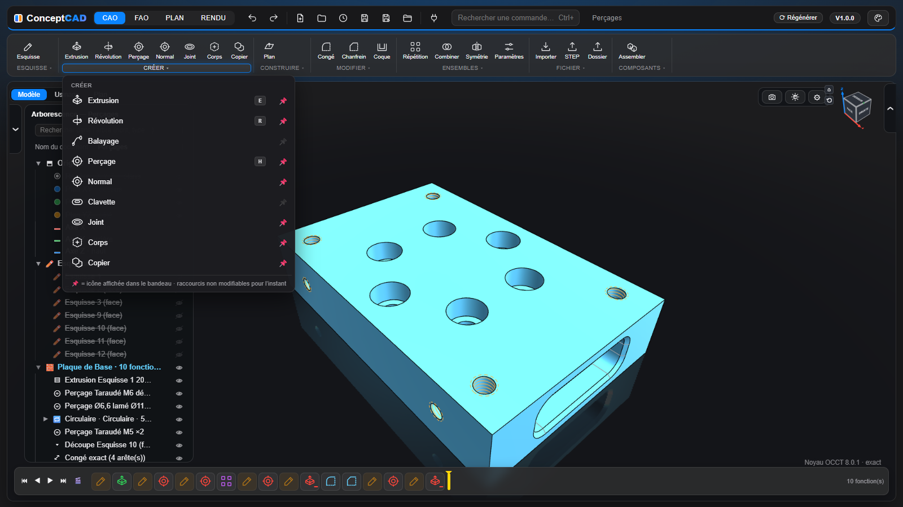

[ConceptCAD](../../README.md) › [Manuel](README.md) › Interface

# Interface

Quatre espaces dans le bandeau supérieur : **CAO**, **FAO**, **PLAN** et **RENDU**.
- **Bandeau** : barre rapide (annuler, rétablir, fichiers), **recherche de commandes** (`Ctrl+K`), état du noyau, **Régénérer**, nom du document (● = modifications non enregistrées ; les calculs faits en fond, comme la remise à jour des parcours FAO, ne l’allument pas) et version.
- **Ruban à icônes** propre à chaque espace ; en esquisse, il laisse la place au bandeau d'esquisse.
  - Comme dans Fusion 360, le **nom de chaque groupe** (Créer ▾, Modifier ▾…) ouvre la liste de toutes ses fonctions, avec leur **raccourci clavier**.
  - L'**épingle 📌** choisit celles qui restent aussi dans le ruban ; les moins courantes n'y sont plus par défaut, pour gagner de la place.
  - Un ruban qui passerait à la ligne resserre ses boutons pour tenir sur une seule.
  - En PLAN, le bouton de l'outil en cours reste allumé tant que l'outil est actif.
- **Écran de démarrage** animé de 6 s, logo bleu et orange ; un clic ou `Échap` le passe.
- **Navigateur Modèle / Usinage / Plan** à gauche, avec des **onglets de posages** ; **propriétés** à droite ; **timeline** en bas de la vue 3D.
  - La **vue 3D va jusqu'au bord droit** : le panneau Paramètres flotte par-dessus, comme l'arborescence (même fond transparent, contour, flou de la pièce dessous, barre de défilement discrète), tout en haut à droite.
  - Son **onglet de repli** est collé au bord droit ; le **cube et ses icônes** se rangent à sa gauche et suivent son ouverture.
  - **Ouverture automatique** : en CAO, le panneau s'ouvre sur une fonction, une esquisse ou un corps, et se replie quand on clique ailleurs — sauf si la fonction n'est pas encore validée (OK, Valider, Appliquer). En FAO, il s'ouvre au choix d'un posage ou d'une opération et ne se referme pas seul.
  - **Fonction non validée** : un clic sur une autre fonction est refusé ; une boîte le rappelle avec **Valider et continuer**, **Annuler les modifications** ou **Rester**.
  - La pièce est **centrée sur toute la vue 3D** : ouvrir ou replier un panneau ne la déplace plus.
  - Le **nom du document** se modifie en tête de l'arborescence, au-dessus d'Origine.
  - **Listes compactes** : les listes d'un panneau (opérations répétées, trous d'un perçage, corps à usiner, fonctions répétées, arêtes d'un congé, faces d'une coque, d'une dépouille, d'un déplacement ou d'une scission, relations d'assemblage, corps et paramètres à dériver) tiennent sur **une ligne par élément**, en petit, avec le strict minimum (« 1. Ébauche 3D ↻3 », « Ø5.5 × 4 · déb. », « Face 2 »). Le détail (position, profondeur, raison d'une case grisée…) s'affiche en **survolant la ligne** ; un clic sur le texte coche la case.
- **Sélection synchronisée** : cliquer une face l'allume et **surligne** la fonction qui l'a créée dans l'arbre et la timeline, sans l'ouvrir (ni panneau, ni flèche) ; un clic sur cette ligne l'ouvre avec sa flèche. `Ctrl+clic` ne fait que mesurer, sans rien sélectionner.
- **Clic long = choisir sous le clic** : un appui d'une demi-seconde sans bouger liste toutes les faces traversées (de l'avant vers l'arrière, même cachées) et les arêtes proches ; l'élément survolé s'allume à travers la matière, un clic sur sa ligne ou `Entrée` le prend, y compris dans une fonction qui attend une face ou une arête (congé, perçage, coque…).
- **Fenêtres de fonctions** à boutons-icônes, aperçu immédiat, poignées dans la vue, **Annuler / OK**.
- **Barre de progression** à l'ouverture d'un document, au chargement du noyau et sur **⟳ Régénérer** : bandeau semi-transparent en bas de la vue 3D, au-dessus de la timeline.
  - Elle donne l'avancement (n / total), le nom de la fonction et celui de l'esquisse en cours.
  - Elle prend la couleur de la fonction calculée (celle de la timeline).
  - Sur ⟳ Régénérer, elle s'affiche dès le clic ; ailleurs, seulement si la régénération dure.
- **Recalcul en arrière-plan** après une modification (fiche d'une fonction, fenêtre de fonction, paramètre, œil, marqueur de la timeline, annulation, sortie d'esquisse) : si le calcul dure, la main revient tout de suite. L'ancienne pièce reste affichée, la vue tourne, et un bandeau sans voile montre l'avancement. La nouvelle pièce s'affiche d'un coup quand elle est prête. Une autre modification pendant ce temps relance le calcul sur le nouvel état. La FAO attend la nouvelle pièce. Les esquisses projetées sont réglées dans le même calcul. `?sansfond` dans l'adresse : calcul d'un seul tenant, comme avant. Revenir à la valeur précédente (ou annuler) est presque immédiat : les deux dernières versions de la timeline restent gardées. La nouvelle pièce est aussi découpée en triangles pendant ce calcul, pour l'affichage et pour la FAO, avec tous les cœurs du noyau : elle s'affiche sans à-coup.
- **Bandeau « calcul en cours »** pendant le recalcul d'une pièce lourde après la modification d'un paramètre, et **nom du noyau** en clair en bas de la vue 3D.
- **Annuler / Rétablir partout** (`Ctrl+Z` / `Ctrl+Y`) : CAO, esquisse, assemblage, FAO, PLAN et RENDU.
- **Apparence** (menu 🎨) :
  - **cinq thèmes** : Nuit, Graphite, Atelier, Clair, Contraste élevé ;
  - **quatre interfaces du futur** (partie « Interfaces du futur » du même menu) : c'est l'allure de toute l'application qui change, vue 3D comprise ; chacune a aussi **sa propre disposition**, celle de sa maquette (menu 🎨 › *Disposition de la maquette* décochée : disposition habituelle, couleurs gardées ; pour la Goutte, c'est la bulle qui la porte) :
    - **Habitacle** : poste de pilotage bleu nuit, traits cyan lumineux, coins de visée sur la vue. Il a **sa propre disposition**, celle de sa maquette :
      - une **visière** suspendue en haut : bandeau et ruban réunis au milieu ; les commandes deviennent des **pods** carrés (l'icône seule, le nom au survol), séparés par groupe d'un point lumineux ; **▾** à droite de chaque groupe ouvre toujours sa liste complète, avec les raccourcis ;
      - en CAO, deux **écrans inclinés** : à gauche l'**HISTORIQUE** (l'arborescence, avec le nom de la pièce en grand), à droite les **RÉGLAGES** (le panneau des paramètres, cadre orange). Ils se redressent dès que la souris y va ;
      - la **frise des fonctions** en bas au milieu : un rail lumineux, un point par étape (plus petit pour une esquisse), l'étape choisie en orange. Clic, double-clic et glisser marchent comme dans la timeline ;
      - la **jauge de masse** en bas à gauche : masse, volume et matière des corps affichés (aluminium quand un corps n'a pas de matière) ; l'anneau montre combien la pièce remplit sa boîte englobante ;
      - le **gyroscope** en bas à droite : le cube de vue ceint de ses anneaux X, Y, Z ;
      - **sous le curseur** : la face survolée est nommée à côté de la souris (« Face 26 · Découpe … ») ;
      - en haut de la vue : l'espace, le nombre de fonctions et l'état (enregistrée / modifiée).

      Dans les autres espaces, le même habitacle :
      - **assemblage** : l'écran incliné **ASSEMBLAGE** (l'arbre), la frise des étapes (insertions, relations, liaisons) en bas au milieu, la jauge qui compte les pièces, les étapes, les relations et les liaisons (l'anneau : étapes rejouées jusqu'au marqueur) ;
      - **FAO** : l'écran incliné **USINAGE** (l'arbre de l'usinage, avec le nom du posage), le **rail des opérations** en bas au milieu (une puce par posage, un point par opération du posage choisi : clic = sa fiche), la jauge des opérations à jour ;
      - **PLAN** : le panneau de la planche incliné à droite, cadre orange, et la jauge de la planche (vues, cotes) ;
      - l'état en haut de la vue dit l'espace et ce qu'on y fait (ESPACE FAO · USINAGE, ASSEMBLAGE · nom…).

      L'esquisse garde sa disposition, sous la visière. Menu 🎨 › *Disposition de la maquette* (décochée) rend la disposition habituelle en gardant les couleurs : l'arborescence et les paramètres restent alors légèrement inclinés ;
    - **Table holographique** : noir profond, sarcelle et ambre, anneau de lumière sous la pièce, espaces de travail sur un arc de lumière ; sa disposition :
      - la **table** : une grande ellipse lumineuse en bas de la vue, avec le nom de la pièce, sa matière, sa masse et son volume écrits sur l'anneau ; sa moitié arrière s'efface pour ne pas cacher la pièce ;
      - les **espaces autour de la table** : CAO devant, FAO à gauche, PLAN au fond, RENDU à droite ; un clic y va ;
      - les **commandes sur l'arc avant** de la table (plus de ruban) : d'abord les groupes (Esquisse, Créer, Modifier…), un groupe y déroule toutes ses commandes, **‹** revient. Elles sont rangées côte à côte le long du bord de la table, sur deux rangées alignées quand elles sont nombreuses. `Ctrl+K` et les raccourcis restent ;
      - l'**histoire de la pièce** à gauche : les fonctions empilées en tranches de cylindre, la plus ancienne en bas (une tranche fine par esquisse), nom et valeur à côté, l'étape choisie en ambre. Clic, double-clic et glisser comme dans la timeline ; **Histoire · Arbre** en haut à gauche montre l'un ou l'autre ;
      - le **cadran** à droite : la valeur principale de la fonction choisie (profondeur, hauteur, Ø, angle) sur un arc. Après un clic sur une face de la pièce, on fait glisser le curseur ou on tape la valeur puis `Entrée` : la pièce est refaite, `Ctrl+Z` revient. Quand la fonction est ouverte dans sa fenêtre, c'est la fenêtre qui règle (OK ou Annuler) et le cadran ne fait que montrer ;

      Dans les autres espaces, la même table (le cadran reste à la CAO) :
      - **assemblage** : l'arc porte les commandes de l'assemblage (Modéliser, Composant, Relations…, sans groupes), l'**histoire de l'assemblage** s'empile à gauche (le nom de la pièce et la nature de l'étape à côté de chaque tranche ; marqueur et glisser comme dans la barre de l'assemblage) ; l'anneau compte les pièces, les étapes, les relations ;
      - **FAO** : l'arc porte les groupes de la FAO (Posage, Limites, Opérations…), l'**histoire de l'usinage** s'empile à gauche (le posage en socle ambré, les opérations en tranches, esquisses et corps en tranches fines ; clic = sa fiche) ; l'anneau compte les posages, les outils, les opérations ;
      - **PLAN** : l'arc porte les groupes du PLAN (Planches, Vues, Cotes…) au-dessus de la feuille, les **planches** s'empilent à gauche, la table reste claire sur le papier ; l'anneau dit le format, les vues, les cotes.

      L'esquisse garde la disposition habituelle ;
    - **Plan vivant** : bleu d'architecte, vue quadrillée dans un cadre de planche, angles vifs, boutons en pochoir (blancs quand ils sont choisis) ; l'espace PLAN prend le même bleu ; il a **sa propre disposition**, celle d'une planche à dessin :
      - la **règle trace-formes** en haut : le ruban devient une règle de dessinateur translucide, posée de biais et graduée ; chaque commande y est une découpe, son nom au pochoir dessous ; le nom d'un groupe ouvre toujours sa liste complète ;
      - en CAO, la vue devient une **planche** : double cadre, repères de zones 1 à 6 et A à D ;
      - la **frise en cote de chaîne** en bas à gauche : chaque fonction est une cote entre deux traits de rappel, son nom et sa valeur écrits à la main au-dessus (« Extrusion 30 », « Découpe 6 »), l'étape choisie en jaune. Clic, double-clic et glisser comme dans la timeline ;
      - le **cartouche** en bas à droite : nom de la pièce, les espaces en **tampons** (CAO, FAO, PLAN, RENDU ; celui de l'espace en cours encré de biais), la nomenclature des fonctions (REP · FONCTION · RÉGLAGE : un clic choisit la fonction, un double-clic l'ouvre), la matière, la masse et le volume ;
      - l'**annotation vivante** : un clic sur une face écrit, au bout d'une ligne de rappel, la fonction qui l'a créée et sa valeur (« DÉCOUPE · profondeur 6 mm ») ; la changer puis `Entrée` refait la pièce, `Ctrl+Z` revient, `Échap` ou un clic ailleurs l'efface.

      Dans les autres espaces, la même planche :
      - **assemblage** : la **frise de l'assemblage** en cote de chaîne (une cote par étape : la pièce et la nature de l'étape), le cartouche dont la nomenclature devient REP · PIÈCE · QTÉ (un clic choisit la pièce) ;
      - **FAO** : la **frise de l'usinage** en cote de chaîne (une cote par posage, puis une par opération du posage choisi, avec son outil « T6 Ø25 »), le cartouche REP · OPÉRATION · OUTIL (un clic : sa fiche) ;
      - **PLAN** : les planches en cote de chaîne au-dessus de la feuille, le cartouche en bas à gauche avec REP · PLANCHE · FORMAT (un clic affiche la planche).

      Les espaces sont les tampons du cartouche partout ; l'esquisse garde sa disposition. Menu 🎨 › *Disposition de la maquette* décochée : disposition habituelle, couleurs gardées ;
    - **Goutte** : tons chauds, panneaux en galets de verre, boutons ronds, menus du clic droit en gouttes qui ondulent doucement tant qu'ils sont ouverts. Et surtout **la bulle d'actions** : un clic sur une face ou une arête de la pièce (espace CAO) fait apparaître, à côté de la souris, une goutte de verre avec ce qu'on peut faire à cet endroit :
      - face plane : *Esquisse ici*, *Déplacer la face*, *Évider (coque)*, *Dépouille*, *Coter* ;
      - face cylindrique (trou, axe) : *Fileter*, *Déplacer la face*, *Coter* ;
      - arête : *Congé*, *Chanfrein*, *Coter* ;
      - pour une face, *Modifier « … »* ouvre la fonction qui l'a créée (la poche, l'extrusion…), comme un double-clic dans la timeline.

      La commande démarre avec la face ou l'arête **déjà prise** : le congé a son arête, le déplacement sa face ; il ne reste qu'à régler la valeur. La bulle d'une face montre aussi la **valeur de la fonction qui l'a créée** (profondeur d'une découpe, hauteur d'une extrusion, Ø d'un perçage, angle) : la changer puis `Entrée` refait la pièce, `Ctrl+Z` revient. La bulle se ferme au moindre geste ailleurs (clic, molette, touche, `Échap`) et ne vient jamais pendant un outil, en esquisse ni en tournant la vue. *Ne plus montrer* (dans la bulle) la coupe ; menu 🎨 › *Bulle d'actions près de la souris* la remet.

      Avec la bulle, la Goutte a **sa propre disposition** en CAO, celle de sa maquette :
      - **plus de ruban** : toutes les commandes viennent dans une goutte, d'un clic dans le vide quand rien n'est sélectionné, ou sur **+ la suite** en haut de la tige ; elles y sont rangées en galets (Créer, Modifier…), un galet ouvre ses commandes. `Ctrl+K` et les raccourcis restent ;
      - **l'historique pousse en tige** à gauche, de bas en haut : un bourgeon par fonction, une feuille par esquisse, avec leur nom et leur valeur. La pousse verte du haut est le marqueur temps : la glisser vers le bas rejoue la pièce plus tôt. Clic, double-clic et glisser d'une fonction marchent comme dans la timeline ;
      - **Tige · Arbre**, en haut à gauche de la vue, montre l'un ou l'autre ;
      - en haut, les espaces en galets au milieu et des orbes à droite : annuler, rétablir, enregistrer (les autres boutons de fichier sortent au survol).

      Dans les autres espaces, la même goutte (plus de ruban) :
      - **assemblage** : la **tige de l'assemblage** (un bourgeon par étape, le nom de la pièce et la nature de l'étape ; la pousse du haut est le marqueur, la glisser vers le bas rejoue l'assemblage plus tôt), **Tige · Arbre**, la goutte de toutes les commandes de l'assemblage d'un clic dans le vide ;
      - **FAO** : la **tige de l'usinage** (le posage en nœud de bois, les opérations en bourgeons avec leur icône, esquisses et corps en feuilles ; les pastilles des posages au pied), la goutte des commandes de la FAO d'un clic dans le vide ou sur **+ la suite** ;
      - **PLAN** : **+ la suite** en haut à gauche de la planche ouvre la goutte des commandes du PLAN ; les planches deviennent des galets.

      L'esquisse garde son ruban ; couper la bulle rend la disposition habituelle.
    - **Dans les quatre** : quand le panneau des réglages s'ouvre, rien ne glisse (table, frises, rail, cartouche, gyroscope restent à leur place ; seules les commandes de la table se rangent dans la partie de l'arc restée visible). Avec plusieurs posages, l'usinage ne montre que celui de la pastille choisie (dans toute l'interface moderne, quel que soit le thème).
    Les arêtes de la pièce prennent la teinte du thème (foncée, lisible sur une pièce claire comme sur une sombre). Au repos, rien ne bouge : la vue en veille ne fait pas souffler la carte graphique ;
  - **fiches illustrées au survol**, façon dessin animé (actives par défaut, ⚙ → Affichage pour les couper) : une image avant → après qui s'anime, une phrase simple, les étapes et le raccourci de chaque icône ;
  - **quatre styles d'icônes** : au trait, couleurs par famille (une teinte par groupe du ruban), dessinées en volume, délire.
- **Vue 3D** : cube de vue (axes X rouge, Y vert, Z bleu épais, fléchés et lettrés, qui dépassent du cube), orbite contrainte ou libre, centre de rotation sur le point visé, zoom vers le curseur, sol miroir, transparence « verre », **effet de perspective** réglable (de presque orthographique à fuyantes marquées, la pièce garde sa taille).
- **Vue en veille** : à l'arrêt, la vue 3D ne se redessine plus en continu (la carte graphique d'un portable souffle, même avec une pièce lourde) ; elle repart à pleine vitesse au moindre geste. `?sansveille` dans l'adresse garde l'ancien affichage continu.
- **Modification d'une grosse pièce** : seules les faces neuves ou modifiées sont remaillées et leurs arêtes reclassées, le reste est repris tel quel (mêmes triangles, mêmes arêtes). `?sansfacettes` dans l'adresse redonne le calcul complet, `?sansindex` l'ancienne recherche de la face sous la souris.
- **Coupe X / Y / Z** (⚙ › Coupe) : plan de coupe glissé ou saisi au mm, côté inversable, faces coupées remplies.
- **Lentilles** (bouton loupe de la barre de vue) : une loupe ronde posée sur la pièce montre, dessous, l'intérieur (Coupe), les passes, la fraise et le temps de coupe de la zone (FAO), la pièce au trait cotée (Plan) ou sa vraie matière (Rendu) ; le reste de la vue ne bouge pas. Voir [Lentilles](lentilles.md).
- **La pièce qui propose** (bouton étincelle de la barre de vue) : après chaque fonction, la suite probable dans une bande discrète en bas de la vue. Voir [La pièce qui propose](piece-propose.md).
- **Rendu direct** (bouton de la barre de vue) : la vue CAO ou FAO prend les matériaux, reliefs et patine de l'atelier RENDU, son ambiance et son fond, en temps réel.
- **Journal d’erreurs** : les plantages sont notés sur l’ordinateur, sans aucun envoi ni contenu de la pièce. Dans l’**Aide** (F1 hors esquisse) : enregistrer, copier ou vider le journal, pour faire analyser les pannes.

---
# Les diiférentes interface futuristes :

## L'habitacle

## La table holographique

## Le plan vivant

## La goutte

[← Démarrage](demarrage.md) · [Sommaire du manuel](README.md) · [Téléphone et tablette →](telephone.md)
