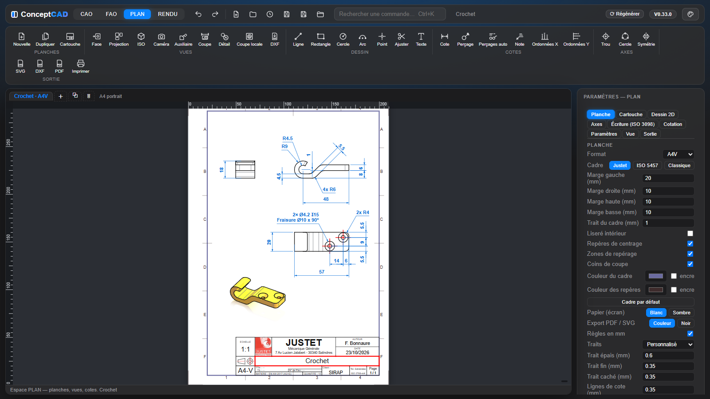

[ConceptCAD](../../README.md) › [Manuel](README.md) › PLAN

# PLAN

Le retour dans le Plan est immédiat tant que la géométrie de la pièce n’a pas changé, et Ctrl+Z / Ctrl+Y sur un geste de plan ne recalculent ni la pièce ni les vues. Le recalage automatique des cotes sur la pièce modifiée ne compte pas comme une étape : un seul Ctrl+Z ramène la pièce, ses vues et ses cotes.

## Planches

- **Formats** A4 à A0, paysage ou portrait, ou format manuel ; plusieurs planches en onglets.
- **Cadre** réglable (préréglages Justet, ISO 5457, Classique), **cartouche** dessiné en esquisse contrainte et éditable avec logo, **nomenclature** et tableau des révisions ; le **cartouche d'entreprise** peut venir d'un modèle externe, gardé hors du dépôt.
- **Écriture ISO 3098** et paramètres du plan enregistrés par projet (`.mfplan`).
- **Paramètres et formules** dans les champs de la planche (format, cadre, révisions, tolérances, textes) : la formule reste affichée et la valeur suit les paramètres.

## Vues

- **Face, projection, ISO, caméra, auxiliaire, coupe et détail**, par corps ou en assemblage (une hachure par pièce, bulles automatiques).
  - **Assemblage** : à l'ouverture d'une planche vide, une seule vue de face de tout l'assemblage, avec tous ses composants (V0.94.8). Une pièce seule reçoit toujours face, dessus et côté.
- **Orientation de la vue principale** : Face, Arrière, Côté gauche, Côté droit, Dessus, Dessous ; les projections suivent.
- **Échelle d'une vue** : de 5:1 à 1:10, dont 3:4, 1:6 et 1:8 ; **Autre…** pour taper l'échelle de son choix (2:3, 1/7, 0,75). Le cartouche l'écrit en fraction (3:4, et non 1:1.33) (V0.95.7).
- **Rotation d'une vue de 90°**, à gauche (↺) ou à droite (↻) : elle tourne sur place avec ses cotes, axes, lignes de coupe et détails ; les projections sont recalculées et réalignées.
- **Arêtes exactes** du noyau (HLR OCCT), y compris pour un STEP importé.
  - **Arêtes cachées** (« cachées en pointillé ») : seules celles qui ne sont pas recouvertes par un trait visible sont dessinées (V0.97.1) ; sans cachées choisies, elles ne sont pas extraites du calcul.
  - **Assemblage rapide** : chaque pièce n'est préparée qu'une fois, quel que soit son nombre d'occurrences (V0.97.1).
  - **Tangentes grises comme dans la 3D**, dans les vues comme dans les coupes (même les raccords que le noyau croit vifs).
  - Perspective et cavalière.
  - **Rendu réaliste** des vues au choix ; en assemblage, chaque pièce avec son matériau et sa texture de rendu.
- **Ligne de coupe** droite ou brisée (ISO 128-44), **hachures** (ISO 128-50), **filetages** (ISO 6410), **axes** (ISO 128-2) étirables et cotables ; nom de vue affiché seulement sur les coupes et détails.
- **Coupe locale** : contour libre plus une arête du plan, modifiable ou supprimable (double-clic sur ses hachures) ; les filetages coupés y sont représentés comme dans une vue en coupe.
- **Import DXF** : un dessin DXF (lignes, arcs, polylignes, splines, blocs) devient une vue de la planche.

## Cotation et sorties

- **Cote** unique (longueur, distance, Ø, rayon, angle) avec **accrochages** imposés (extrémité, milieu, extrême X / Y, intersection), **cotation en chaîne** depuis une ligne de rappel, cotes d'angle sur les quatre secteurs, texte collé à l'arc et déplaçable.
  - Un **cercle ou un arc cliqué donne son centre** : distance, chaîne et ordonnées partent du centre du trou, pas du point cliqué sur le bord.
- **Oblongs** repérés par leurs 2 centres : un clic de l'outil Axes pose les centres et l'axe ; entraxe et position sont cotés depuis les centres, et suivis quand la pièce change.
- **Rainures circulaires** (oblong en arc vu de face) : un clic pose l'arc d'axe, les traits vers les centres des bouts et la croix du centre ; les cotes s'accrochent aux centres des bouts.
  - Un Ø sur un arc incomplet (bout de rainure) n'a qu'une flèche, et son trait dépasse le centre (ISO 129-1).
  - L'**arc d'axe se cote en rayon ou en diamètre**, et ses **2 traits en angle**.
- **Esquisse de planche** : l'outil Cote vise aussi ses lignes, cercles et arcs (en trait d'axe ou non) ; la cote suit le tracé.
- **Supprimer un axe automatique** (croix du centre d’un cercle, axe de trou) : Suppr ; sur un axe posé à la main, Suppr sur sa croix de centre ne retire que la croix. « Réafficher » dans le panneau de la vue les rend.
- **Tolérances géométriques ISO 1101** (les 14 caractéristiques, Ø, modificateurs Ⓜ Ⓛ Ⓔ Ⓟ Ⓕ CZ, jusqu’à 3 références) et **références ISO 5459** (A, B, C…, sans I, O, Q) : cadre à flèche sur une arête ou sous la valeur d’une cote, triangle sur une arête ou au bout d’une cote (axe, plan médian) ; ils suivent la pièce et partent avec leur cote.
- **Rugosité** (état de surface, ISO 21920-1 / ex-ISO 1302) : symbole posé sur l'arête du côté hors matière, perpendiculaire à elle.
  - Valeur « Ra 3,2 » (Ra, Rz…) sous le trait de la branche longue, lisible du bas ou de la droite du plan.
  - Si ce côté se lirait à l'envers (dessous d'une arête, droite d'une arête verticale), ou si on l'éloigne, le symbole passe par une ligne de repère à flèche.
  - Usinage exigé, tout procédé ou enlèvement interdit, procédé facultatif.
- **Filigranes** : « BON POUR FABRICATION », « ANNULÉ », « PLAN INTERNE » ou texte libre, en grandes lettres transparentes au centre de la planche, en diagonale ; on le glisse, on règle angle, taille, 1 ou 2 lignes, couleur et opacité. Il sort en SVG, PDF, impression et DXF.
- **Tolérances ISO 286** (toutes les classes, alésages A … ZC et arbres a … zc, IT01 … IT18, ajustements) ; les cotes sont associatives et **suivent une modification du 3D**.
- **Perçages** cotés depuis la fonction Perçage :
  - « Perçages auto » cote toute la planche ; la tolérance d'un alésé s'y écrit d'office ;
  - un trou coupé par une autre fonction reste reconnu ;
  - l'outil Perçage cote le trou dans toutes les vues : vu de bout, de côté ou en biais, en coupe comme avec les traits cachés.
- **Ordonnées X / Y** (avec cassure), notes à flèche.
- **Précision des cotes** au choix : 0, 0.1, 0.01 ou 0.001, cote par cote ou par défaut pour tout le plan.
- **Hauteur du texte** des cotes, avec flèches et tolérances proportionnelles (écarts au niveau de la valeur, quel que soit le sens de la cote) ; épaisseur des lignes d'attache et des axes de trous ; **Sauvegarder par défaut** / **Appliquer les défauts**.
- **Dessin 2D** sur la planche avec contraintes.
- **Sorties** : SVG, **DXF R12** par calques, **PDF** au format exact, impression (dans une fenêtre dédiée), en couleur ou tout en noir.

---

[← FAO](fao.md) · [Sommaire du manuel](README.md) · [RENDU →](rendu.md)
